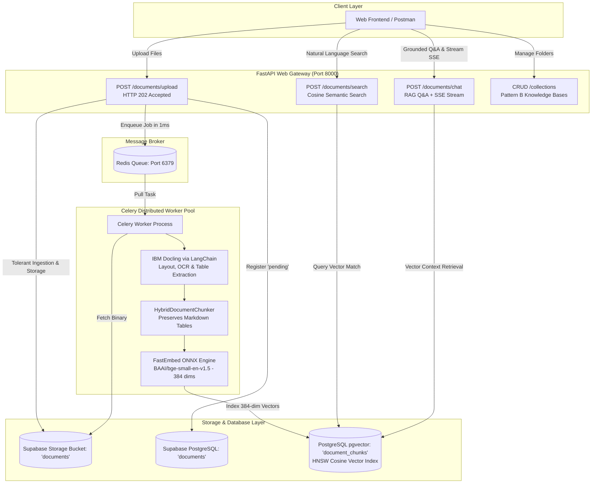

# AI Document Intelligence Platform

> Enterprise-grade asynchronous document ingestion, layout-aware parsing, hybrid chunking, and semantic vector search powered by **FastAPI**, **LangChain**, **IBM Docling**, **FastEmbed**, **Celery + Redis**, and **Supabase PostgreSQL (`pgvector`)**.

---

## 🧭 Technical Documentation Suite

For comprehensive deep-dive guides on each subsystem, architectural decisions, and database schemas, visit the documentation directory:

| Chapter | Deep-Dive Technical Guide | Core Architecture & Topics Covered |
| :---: | :--- | :--- |
| **Index** | [**Documentation Blueprint & Master Index**](./docs/README.md) | High-level system architecture flowchart, technology stack matrix, component interaction map |
| **01** | [**Storage Architecture & Ingestion Pipeline**](./docs/01_storage_and_ingestion.md) | Tolerant Batch Ingestion, Supabase Cloud Storage, Private Bucket Security, Signed URLs |
| **02** | [**Collections & Organization (Pattern B)**](./docs/02_collections_and_organization.md) | Smart Folder Hierarchy, Entity-Relationship Data Model, Two-Tier Storage & Database Cascade Delete |
| **03** | [**Distributed Task Queue (Celery + Redis)**](./docs/03_asynchronous_celery_pipeline.md) | Process Isolation, Late ACKs (`task_acks_late`), OOM Memory Safety, Celery Worker Pools |
| **04** | [**Layout-Aware Parsing & Hybrid Chunking**](./docs/04_parsing_and_chunking.md) | IBM Docling Engine, Table Integrity Preservation, LangChain Integration, Async Thread Isolation |
| **05** | [**Vector Embeddings & pgvector Indexing**](./docs/05_embeddings_and_vector_store.md) | Zero-Cost FastEmbed ONNX Engine, PostgreSQL `pgvector`, HNSW Cosine Indexing, Tenant Scoping |
| **06** | [**Semantic Search & Frontend Integration**](./docs/06_semantic_search_and_api_guide.md) | Semantic Similarity Retrieval, Source Citations, UI Blueprints (Search Bar, Inspector, Polling) |
| **07** | [**Pluggable LLM Layer & RAG Generation**](./docs/07_llm_and_rag_orchestration.md) | Multi-Provider LLM Factory (Groq, Gemini, Ollama, OpenAI), Zero-Cost Setup, Smart Defaults |

---

## 🏗️ High-Level System Architecture



---

## ⚡ Key Architectural Highlights

1. **Tolerant Batch Ingestion with Actionable Failure Reporting:**
   * Validates and ingests each file independently. Valid files are saved to cloud storage, recorded with status `pending`, and enqueued to Celery.
   * Invalid, oversized, or corrupted files are isolated in the `failed` response array with exact error details, enabling 1-click retry without blocking valid documents.
   * If 100% of files in a batch fail, the request returns `HTTP 400 Bad Request`.
2. **Layout-Aware Parsing (IBM Docling via LangChain):**
   * Preserves complex multi-column tables as **intact Markdown tables** instead of flattening them into broken text strings.
   * Isolates CPU-heavy OCR and layout parsing inside background worker threads (`asyncio.to_thread`).
3. **Zero-Cost High-Throughput Embeddings (FastEmbed):**
   * Runs `BAAI/bge-small-en-v1.5` on a lightweight **ONNX Runtime (~50MB)**.
   * Completely eliminates paid external APIs (OpenAI) and heavy PyTorch installations (3GB–4GB).
4. **Sub-Millisecond Vector Retrieval (Supabase `pgvector` + HNSW):**
   * Uses **HNSW (`vector_cosine_ops`)** indexing on a 384-dimensional vector column.
   * Multi-tenant scoping guarantees that searches never leak across users or outside designated collections.
5. **Process-Isolated Distributed Worker Queue (Celery + Redis):**
   * Web server returns **`HTTP 202 Accepted`** in $< 2$ milliseconds.
   * Background processing runs in dedicated Celery worker processes with `task_acks_late=True` and `worker_prefetch_multiplier=1` to prevent memory exhaustion and lost tasks.
6. **Grounded RAG & Inline Citations (LangChain LCEL):**
   * Pluggable LLM Factory (Groq, Gemini, Ollama, OpenAI) with strict anti-hallucination guardrails.
   * Zero-token fast-exit optimization returns immediate answers when context is empty.
   * Real-time Server-Sent Events (SSE) token streaming with structured page and chunk citations.

---

## 🚀 Quickstart & Local Setup

### 1. Prerequisites
* Python $\ge 3.12$
* [`uv`](https://github.com/astral-sh/uv) (Extremely fast Python package installer and resolver)
* A running PostgreSQL database with `vector` extension enabled (e.g. Supabase)
* A Redis instance (for Celery task broker)

### 2. Installation
Clone the repository and install all dependencies:
```bash
uv sync
```

### 3. Environment Configuration
Create a `.env` file based on `.env.example`:
```bash
cp .env.example .env
```
Fill in your credentials:
* `DATABASE_URL`: Supabase PostgreSQL connection string.
* `SUPABASE_URL` & `SUPABASE_KEY`: Supabase project URL and service role key.
* `CELERY_BROKER_URL`: Redis connection string (`redis://localhost:6379/0`).

### 4. Database Migrations
Apply all schema migrations (including `document_chunks` table and `pgvector` HNSW indexes):
```bash
uv run alembic -c app/infrastructure/database/alembic.ini upgrade head
```

### 5. Running the Application

You will run **three independent services** (or use Docker Compose):

#### Terminal 1: Start Redis
```bash
docker run -d -p 6379:6379 --name redis redis:7-alpine
```

#### Terminal 2: Start the FastAPI Web Server
```bash
uv run uvicorn app.main:app --reload --port 8000
```

#### Terminal 3: Start the Celery Worker Process
* **On Windows:**
  ```bash
  uv run celery -A core.celery_app.celery_app worker --loglevel=info -P solo
  ```
* **On Linux / Docker:**
  ```bash
  uv run celery -A core.celery_app.celery_app worker --loglevel=info --concurrency=4 -E
  ```

---

## 📬 Postman Collection

A complete, zero-configuration Postman collection is maintained at:
[`ai-document-intelligence-platform.json`](./ai-document-intelligence-platform.json)

### Available Request Folders:
* **System & Health:** Health check and database connectivity.
* **Authentication:** Registration, Login, Token Refresh, Password Reset via Google SMTP.
* **Collections:** Full CRUD with active document counts and cascade deletion.
* **Documents:** Multi-file and single-file upload with tolerant batch ingestion.
* **AI Processing & Vector Search:**
  * `POST /documents/{id}/process`: Trigger or re-trigger processing.
  * `GET /documents/{id}/chunks`: Retrieve parsed chunks, tables, and layout metadata.
  * `POST /documents/search`: Semantic similarity search with cosine ranking.
* **RAG & Document Chat:**
  * `POST /documents/chat`: Natural language Q&A across documents with inline citations (`[Source 1]`).
  * `POST /documents/chat` (SSE): Real-time token-by-token Server-Sent Events streaming.
  * `POST /documents/{id}/chat`: Questions scoped strictly to a single document.


