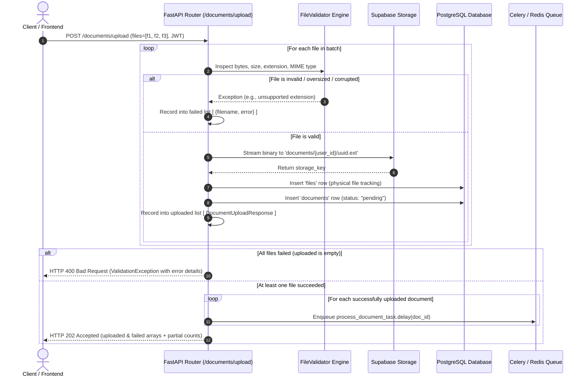

# 01 — Storage Architecture & Document Ingestion System

## 1. Overview & Rationale
The Document Ingestion subsystem is the entry gateway of the platform. It is engineered to accept single or high-volume multi-file uploads (PDFs, Word documents, text files, and high-resolution images), validate them strictly before touching persistent storage, stream binaries into **Supabase Cloud Storage**, register their metadata in **PostgreSQL**, and enqueue background processing via **Celery**.

---

## 2. Why `HTTP 202 Accepted`?
In standard REST design, `200 OK` or `201 Created` implies that the resource is fully created and ready for immediate consumption.

However, in an AI Document Intelligence system:
* Extracting layout from a 50-page PDF or OCR-ing high-res receipts takes **3 to 30 seconds**.
* Generating dense vector embeddings takes additional time.
* If the API waited synchronously for parsing and vector generation before responding, the HTTP request would block, browsers and load balancers would throw **`504 Gateway Timeout`**, and users would face an unusable UI.

**`HTTP 202 Accepted`** establishes an asynchronous contract:
1. The server confirms: *"Your files are valid and safely stored in cloud storage with initial status `pending`."*
2. The server provides immediate unique `document_id`s.
3. The server immediately delegates parsing, chunking, and embedding to distributed **Celery** workers.

---

## 3. Tolerant Batch Ingestion with Actionable Failure Reporting

In real-world business workflows, users frequently upload batches containing multiple documents (e.g., 10 files). Under a strict "all-or-nothing" strategy, if 9 files are valid PDFs and 1 is an unsupported format, corrupted, or oversized file, rejecting the entire batch wastes bandwidth and creates heavy user friction.

The platform employs a **Tolerant Batch Ingestion** architecture:
1. **Independent Per-File Validation & Ingestion:** Each file in the batch is inspected, validated, and stored independently.
2. **Partial Success Preservation:** Valid files are saved to Supabase Storage, recorded in PostgreSQL with status `pending`, and immediately enqueued for Celery background processing.
3. **Actionable Failure Isolation:** Invalid or corrupted files are caught and isolated in the `failed` response array with their exact filename and reason, enabling the frontend to offer a 1-click retry for only the failed items.
4. **Total Failure Guard:** If 100% of the files in a batch fail, the request fails fast with `HTTP 400 Bad Request` (`ValidationException`), preventing empty jobs.
5. **Orphan Cleanup:** If an unexpected error occurs during database recording after a file was written to storage, the storage object is immediately purged to prevent storage leaks.



### Validation Rules Enforced (`FileValidator`):
1. **Empty File Guard:** `size > 0` bytes. Empty files raise `FileEmpty`.
2. **Size Ceiling:** `size <= 50 MB` (enforced in `MAX_DOCUMENT_SIZE`). Larger files raise `FileTooLarge`.
3. **Extension Whitelist:** File extension must belong to:
   ```python
   ALLOWED_DOCUMENT_EXTENSIONS = {
       ".pdf", ".docx", ".doc", ".txt", ".csv", ".md",
       ".png", ".jpg", ".jpeg", ".webp", ".tiff", ".bmp",
   }
   ```
4. **MIME Whitelist with Fallback Guessing:**
   Browsers often send generic `application/octet-stream` for `.md` or `.csv`. The validator inspects `content_type`, and if generic, resolves the true MIME type using Python's `mimetypes.guess_type(filename)`.
5. **Orphan Storage Purge Safeguard:**
   If an unexpected database error occurs after a file was written to Supabase Storage, the `except` block catches the error and deletes the newly created storage object:
   ```python
   except Exception as exc:
       if file_record and hasattr(file_record, "storage_key"):
           try:
               await self.file_service.storage.delete(file_record.storage_key)
           except Exception:
               pass
       failed.append(FailedDocumentUpload(filename=fname, error=str(exc)))
   ```

---

## 4. Cloud Storage Architecture (`StorageProvider`)

The platform isolates storage interactions behind a clean abstract interface:

```
app/infrastructure/storage/
├── base.py       # StorageProvider ABC (upload, delete, exists, get_url, get_signed_url)
├── factory.py    # StorageFactory (instantiates active provider based on config)
├── supabase.py   # SupabaseStorageProvider (storage3.AsyncStorageClient)
├── s3.py         # S3StorageProvider (boto3)
└── local.py      # LocalStorageProvider (local disk fallback)
```

### Supabase Storage Provider Details:
* **Client Library:** `storage3.AsyncStorageClient` (pure asynchronous HTTP storage client).
* **Bucket Configuration:** Default bucket `documents`. The provider verifies bucket existence on startup and creates it automatically if missing:
  ```python
  await self.client.create_bucket(self.bucket_name, options={"public": False})
  ```
* **Security & Access Control:**
  * By default, `SUPABASE_BUCKET_PUBLIC = False`.
  * Files are **not accessible via public URLs**.
  * Access is granted via **time-limited signed download URLs** generated on demand using `get_signed_url(path, expires_in=3600)`.
* **Path Naming Strategy:**
  Files are namespaced by owner and category to prevent collisions and simplify multi-tenant management:
  ```
  documents/{owner_id}/{category}/{unique_uuid}.{extension}
  Example: documents/0ec9c16e-9c93/document/355ff883-df05-457b.pdf
  ```

---

## 5. Database Tracking (`files` vs `documents`)

To ensure clean separation of concerns, physical files and logical documents are split into two database models:

```
┌───────────────────────────────────────┐
│                 files                 │  <-- Physical File Layer
├───────────────────────────────────────┤
│ id: String (UUID PK)                  │
│ storage_key: String                   │  e.g. documents/user_1/doc/uuid.pdf
│ provider: String                      │  e.g. "supabase", "s3"
│ mime_type: String                     │  e.g. "application/pdf"
│ size: Integer                         │  Bytes
│ owner_type: String                    │  "document", "avatar"
│ owner_id: String                      │  User UUID
└──────────────────┬────────────────────┘
                   │ 1:1
┌──────────────────▼────────────────────┐
│               documents               │  <-- Domain / Business Layer
├───────────────────────────────────────┤
│ id: String (UUID PK)                  │
│ user_id: String (FK -> users.id)      │
│ collection_id: String (FK, Nullable)  │
│ file_id: String (FK -> files.id)      │
│ title: String                         │
│ original_filename: String             │
│ status: String                        │  "pending" -> "processing" -> "completed"
│ doc_metadata: JSONB                   │  Parser info, chunk counts, timings
└───────────────────────────────────────┘
```

---

## 6. API Specification: `POST /documents/upload`

* **Method:** `POST`
* **Content-Type:** `multipart/form-data`
* **Authentication:** Bearer JWT Access Token

### Request Parameters:
| Field | Type | Required | Description |
| :--- | :--- | :--- | :--- |
| `files` | `file[]` | Optional* | Multi-file array selection. Accepts 1 to 40+ files at once. |
| `file` | `file` | Optional* | Single file fallback. *(At least one of `files` or `file` is required)* |
| `collection_id` | `string` | Optional | UUID of an existing collection to group documents into. |
| `collection_name`| `string` | Optional | Name of collection to auto-create on the fly if `collection_id` is omitted. |
| `title` | `string` | Optional | Custom title override (applied when uploading a single document). |

### Partial Success Response (`HTTP 202 Accepted`):
```json
{
  "success": true,
  "message": "2 documents accepted for processing into collection (1 file failed)",
  "data": {
    "collection_id": "a1b2c3d4-e5f6-7890-abcd-ef1234567890",
    "total_uploaded": 2,
    "total_failed": 1,
    "document_id": "doc_1111",
    "uploaded": [
      {
        "document_id": "doc_1111",
        "collection_id": "a1b2c3d4-e5f6-7890-abcd-ef1234567890",
        "status": "pending",
        "filename": "q4_report.pdf",
        "mime_type": "application/pdf",
        "file_size": 1048576,
        "created_at": "2026-10-23T00:10:00Z"
      },
      {
        "document_id": "doc_2222",
        "collection_id": "a1b2c3d4-e5f6-7890-abcd-ef1234567890",
        "status": "pending",
        "filename": "supplier_agreement.docx",
        "mime_type": "application/vnd.openxmlformats-officedocument.wordprocessingml.document",
        "file_size": 524288,
        "created_at": "2026-10-23T00:10:00Z"
      }
    ],
    "failed": [
      {
        "filename": "malicious.exe",
        "error": "Unsupported file extension '.exe'. Allowed extensions: .bmp, .csv, .doc, .docx, .jpeg, .jpg, .md, .pdf, .png, .tiff, .txt, .webp"
      }
    ]
  }
}
```

### Complete Failure Response (`HTTP 400 Bad Request`):
When 100% of files in the batch fail validation, the entire request is rejected:
```json
{
  "success": false,
  "message": "Batch upload failed. All 1 file(s) failed: 'malicious.exe': Unsupported file extension '.exe'. Allowed extensions: .bmp, .csv, .doc, .docx, .jpeg, .jpg, .md, .pdf, .png, .tiff, .txt, .webp",
  "data": null
}
```

---

### Navigation
[← Documentation Blueprint](./README.md) | [Next: 02 — Collections & Organization →](./02_collections_and_organization.md)
