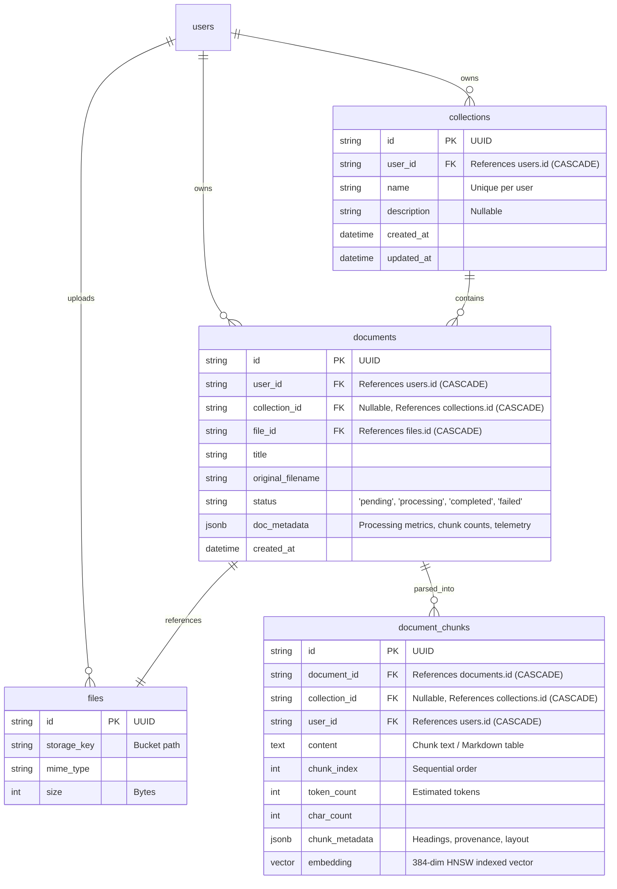
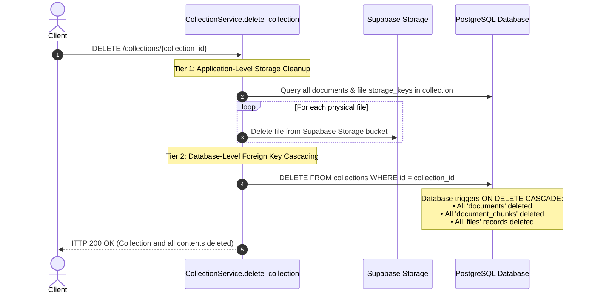

# 02 — Collections & Knowledge Base Organization (Pattern B)

## 1. Overview & Architectural Rationale
In enterprise AI platforms, organizing documents into **Collections** (also known as *Knowledge Bases*, *Smart Folders*, or *Projects*) is the industry-standard design pattern (**Pattern B**).

### Why Collections over Traditional Folders or Tags?
* **Traditional Nested Folders (Tree hierarchy):** Excessive complexity for RAG retrieval. Traversal requires recursive SQL CTE queries, and users easily lose files in deep directory structures.
* **Flat Tags:** Too loose. Tags do not cleanly define deletion boundaries or isolated retrieval scopes.
* **Pattern B (Collections):** Documents belong to dedicated project workspaces (e.g. *"Tax Year 2025"*, *"Legal Contracts"*, *"HR Policies"*).
  * **RAG Retrieval Scoping:** AI vector searches can be scoped to a single collection, preventing irrelevant cross-domain noise.
  * **Access Control & Multi-Tenancy:** Collections define logical data boundaries per user.
  * **Deterministic Lifecycle:** Deleting a collection cascades cleanly to all contained documents, chunks, vectors, and cloud storage files.

---

## 2. Entity-Relationship Data Model



---

## 3. Two-Tier Cascade Delete Architecture

When a user deletes a collection, the platform must guarantee that **no orphaned records remain in PostgreSQL** and **no orphaned binary files remain in Supabase Storage**.

This is implemented using a **two-tier cascade strategy**:



### 1. Database-Level Foreign Key Cascading:
Configured directly in Alembic migrations and SQLAlchemy models:
* `documents.collection_id` references `collections.id` with `ondelete="CASCADE"`.
* `document_chunks.collection_id` references `collections.id` with `ondelete="CASCADE"`.
* `document_chunks.document_id` references `documents.id` with `ondelete="CASCADE"`.

### 2. Application-Level Cloud Storage Cleanup:
Before deleting the collection record, `CollectionService` fetches the storage keys of all associated files and purges them from Supabase Cloud Storage:
```python
async def delete_collection(self, collection_id: str, user_id: str) -> None:
    # 1. Fetch all documents in this collection
    documents = await self.doc_repo.list_all_for_collection(collection_id, user_id)

    # 2. Delete cloud storage binaries for each document
    for doc in documents:
        try:
            file_rec = await self.file_service.get(doc.file_id)
            await self.file_service.storage.delete(file_rec.storage_key)
        except Exception:
            pass  # Continue cleanup even if single storage delete fails

    # 3. Delete collection row -> PostgreSQL automatically cascades to all tables
    await self.collection_repo.delete(collection)
```

---

## 4. Collection Resolution Strategies on Upload

The ingestion endpoint (`POST /documents/upload`) supports three distinct client workflows:

### Strategy 1: Explicit `collection_id`
* **When to use:** The user is already browsing inside a collection in the frontend UI.
* **Behavior:** Verifies that the collection exists and belongs to the authenticated user. Ingests all uploaded documents directly into this collection.

### Strategy 2: On-the-Fly `collection_name` Auto-Creation
* **When to use:** "Create & Upload" modals where the user types a new collection name and drops files simultaneously.
* **Behavior:** `CollectionService.get_or_create_by_name()` checks if a collection with this name already exists for the user. If yes, it reuses it; if not, it automatically creates it and assigns the new `collection_id`.

### Strategy 3: Standalone Document Upload
* **When to use:** Quick standalone uploads from the home dashboard.
* **Behavior:** Both `collection_id` and `collection_name` are omitted. The document is stored with `collection_id = None`, appearing in the user's general document list.

---

## 5. Collections REST API Specification

### 1. Create Collection
* **Endpoint:** `POST /collections`
* **Auth:** Bearer JWT
* **Request Body:**
```json
{
  "name": "Financial Reports 2026",
  "description": "Quarterly earnings, audit files, and tax disclosures"
}
```
* **Response:** `HTTP 201 Created`
```json
{
  "success": true,
  "message": "Collection created successfully",
  "data": {
    "id": "a1b2c3d4-e5f6-7890-abcd-ef1234567890",
    "name": "Financial Reports 2026",
    "description": "Quarterly earnings, audit files, and tax disclosures",
    "document_count": 0,
    "created_at": "2026-10-23T00:15:00Z",
    "updated_at": "2026-10-23T00:15:00Z"
  }
}
```

---

### 2. List Collections
* **Endpoint:** `GET /collections?limit=50&offset=0`
* **Auth:** Bearer JWT
* **Response:** `HTTP 200 OK`
```json
{
  "success": true,
  "message": "Collections retrieved successfully",
  "data": {
    "total": 1,
    "collections": [
      {
        "id": "a1b2c3d4-e5f6-7890-abcd-ef1234567890",
        "name": "Financial Reports 2026",
        "description": "Quarterly earnings, audit files, and tax disclosures",
        "document_count": 8,
        "created_at": "2026-10-23T00:15:00Z",
        "updated_at": "2026-10-23T00:15:00Z"
      }
    ]
  }
}
```

---

### 3. Get Collection Details
* **Endpoint:** `GET /collections/{collection_id}`
* **Auth:** Bearer JWT
* **Response:** `HTTP 200 OK`

---

### 4. Update Collection
* **Endpoint:** `PATCH /collections/{collection_id}`
* **Auth:** Bearer JWT
* **Request Body:**
```json
{
  "name": "Financial Reports 2026 (Updated)",
  "description": "Includes audited Q1-Q4 financials"
}
```
* **Response:** `HTTP 200 OK`

---

### 5. Delete Collection (Cascade Delete)
* **Endpoint:** `DELETE /collections/{collection_id}`
* **Auth:** Bearer JWT
* **Response:** `HTTP 200 OK`
```json
{
  "success": true,
  "message": "Collection and all contained documents deleted successfully",
  "data": null
}
```

---

### Navigation
[← Previous: 01 — Storage & Ingestion](./01_storage_and_ingestion.md) | [Documentation Blueprint](./README.md) | [Next: 03 — Celery & Redis Pipeline →](./03_asynchronous_celery_pipeline.md)
