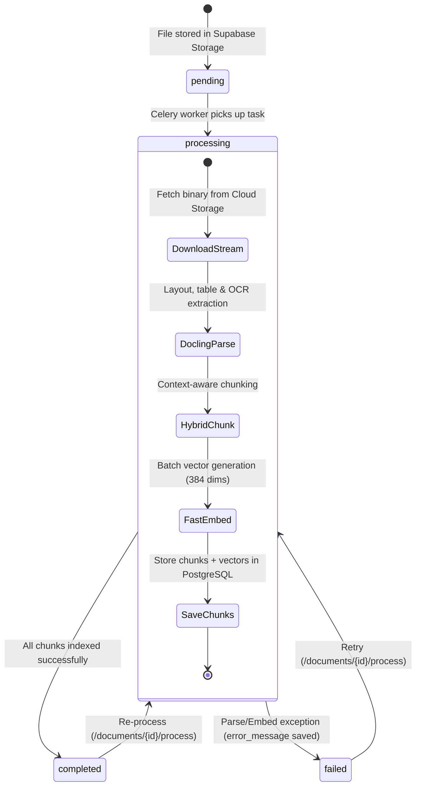

# 03 — Distributed Asynchronous Worker Pipeline (Celery + Redis)

## 1. Why FastAPI `BackgroundTasks` is Insufficient for Production AI

When building proof-of-concept apps, developers often reach for FastAPI’s built-in `BackgroundTasks`. While convenient, **in-process `BackgroundTasks` is an anti-pattern for production AI pipelines**:

| Capability | FastAPI In-Process `BackgroundTasks` | Celery + Redis Distributed Workers |
| :--- | :--- | :--- |
| **Process Isolation** | ❌ **Runs inside web server process.** Heavy Docling OCR or matrix math steals CPU cycles from web threads, causing API latency spikes. | ✅ **Isolated worker processes.** Web server stays at 0% CPU even when processing heavy 50MB PDFs. |
| **Crash & OOM Recovery** | ❌ **In-flight jobs are permanently lost.** If a worker is killed by an OOM killer or server restarts, the task disappears. | ✅ **Zero lost tasks.** With `task_acks_late=True`, uncompleted tasks are automatically preserved in Redis and re-queued. |
| **Queue Persistence** | ❌ **Lives in Python RAM.** If the web container restarts, all waiting tasks vanish. | ✅ **Redis message broker.** Holds thousands of waiting tasks safely in RAM and disk. |
| **Horizontal Scaling** | ❌ Cannot scale workers independently of the API web server. | ✅ **Independent scaling.** Run 1 API container and 10 Celery worker nodes across GPU/CPU clusters. |
| **Retries with Backoff** | ❌ Manual and difficult to implement cleanly. | ✅ **Built-in retries:** `max_retries=3`, `default_retry_delay=60` with exponential backoff. |

---

## 2. End-to-End Distributed Architecture

```mermaid
flowchart LR
    subgraph Client ["Client Layer"]
        Postman[Frontend / Client]
    end

    subgraph WebServer ["Web Server Process (FastAPI: Port 8000)"]
        Router[POST /documents/upload]
        CeleryClient[Celery Client Library]
        Router -->|1. Ingest & Validate| Router
        Router -->|2. Celery delay doc_id| CeleryClient
    end

    subgraph Broker ["Message Broker (Redis: Port 6379)"]
        RedisQueue[(Redis In-Memory Queue<br/>'celery' List)]
    end

    subgraph Workers ["Worker Pool (Celery Process)"]
        CeleryWorker[Celery Worker Process]
        DoclingWorker[Docling Parser Engine]
        EmbedWorker[FastEmbed Embedding Engine]
        CeleryWorker --> DoclingWorker --> EmbedWorker
    end

    subgraph DB ["Database & Cloud Storage"]
        SupabaseStorage[(Supabase Storage)]
        Postgres[(PostgreSQL pgvector)]
    end

    Postman -->|HTTP POST| Router
    CeleryClient -->|LPUSH 'celery'| RedisQueue
    Router -->>|HTTP 202 Accepted (<2ms)| Postman
    RedisQueue -->|BRPOP 'celery'| CeleryWorker
    CeleryWorker -->|Download binary| SupabaseStorage
    EmbedWorker -->|Write vectors| Postgres
```

### The Communication Sequence:
1. **FastAPI (The Producer):**
   When files are uploaded, FastAPI validates them, streams them to Supabase Storage, and calls:
   ```python
   enqueue_document_processing(document_id=doc.id, user_id=user.id)
   ```
   Under the hood, Celery serializes the task into a compact JSON packet and executes an `LPUSH celery` command to Redis over a local TCP socket.
2. **Immediate HTTP Response:**
   FastAPI does not wait for parsing. It receives a `celery_task_id` in **~1 millisecond** and immediately returns **`HTTP 202 Accepted`** to the user.
3. **Redis (The Queue):**
   Holds the task in an in-memory queue list until a worker is free.
4. **Celery Worker (The Consumer):**
   Continuously performs a blocking pop (`BRPOP celery`). As soon as a task arrives, a worker process downloads the file, runs Docling, extracts chunks, generates embeddings, and indexes them into Supabase `pgvector`.

---

## 3. Production Configuration Deep Dive (`core/celery_app.py`)

Our Celery configuration uses battle-tested reliability flags:

```python
from celery import Celery
from core.config import settings

celery_app = Celery(
    "ai_document_intelligence",
    broker=settings.CELERY_BROKER_URL,
    backend=settings.CELERY_RESULT_BACKEND,
    include=["modules.processing.tasks"],
)

celery_app.conf.update(
    task_serializer="json",
    accept_content=["json"],
    result_serializer="json",
    timezone="UTC",
    enable_utc=True,
    task_track_started=True,
    task_always_eager=settings.CELERY_TASK_ALWAYS_EAGER,
    task_acks_late=True,             # Critical: Late acknowledgment
    task_reject_on_worker_lost=True, # Critical: Auto re-queue on worker death
    worker_prefetch_multiplier=1,    # Critical: One heavy doc per worker
)
```

### Why these flags are critical:

#### 1. `task_acks_late = True`
* **Default behavior:** Celery acknowledges and removes the task from Redis the instant it starts reading it. If the server loses power or runs out of RAM 5 seconds later, the document task is permanently lost.
* **Our configuration:** Celery acknowledges the task **only after it completes 100% successfully**. If the worker crashes, Redis detects the closed TCP socket and re-delivers the task.

#### 2. `task_reject_on_worker_lost = True`
* If a worker child process terminates unexpectedly (e.g. killed by the Linux OOM killer while processing a gigantic image), Celery automatically rejects the task, forcing the broker to re-queue it.

#### 3. `worker_prefetch_multiplier = 1`
* **Default behavior:** Celery prefetches 4 tasks into worker memory in advance.
* **Our configuration:** In AI document systems, each document can require 300MB–1GB of working memory during OCR. Prefetching multiple heavy documents can trigger an Out-of-Memory (OOM) crash. Setting `prefetch_multiplier = 1` guarantees that each worker pulls **exactly one task at a time**, finishes it, releases memory, and then requests the next.

---

## 4. State Machine & Execution Telemetry



### Telemetry Recorded in `doc_metadata`:
Upon completion, the Celery task updates the `documents.doc_metadata` column in PostgreSQL with detailed telemetry:
```json
{
  "processing": {
    "parser": "docling",
    "chunker": "hybrid",
    "embedding_provider": "fastembed",
    "embedding_model": "BAAI/bge-small-en-v1.5",
    "total_chunks": 8,
    "parse_duration_seconds": 2.187,
    "chunk_duration_seconds": 0.002,
    "embed_duration_seconds": 0.963,
    "total_duration_seconds": 3.152
  }
}
```

---

## 5. Running Celery in Development vs Production

### Local Development (Windows):
Celery on Windows requires the `solo` execution pool (Windows lacks native POSIX `fork` support):
```bash
uv run celery -A core.celery_app.celery_app worker --loglevel=info -P solo
```

### Production (Linux / Docker):
On Linux, Celery uses the optimized multi-process prefork pool:
```bash
celery -A core.celery_app.celery_app worker --loglevel=info --concurrency=4 -E
```

### Docker Compose Multi-Service Definition:
```yaml
version: "3.8"
services:
  redis:
    image: redis:7-alpine
    ports:
      - "6379:6379"
    restart: always

  api:
    build: .
    command: uvicorn main:app --host 0.0.0.0 --port 8000
    ports:
      - "8000:8000"
    environment:
      - CELERY_BROKER_URL=redis://redis:6379/0
      - CELERY_RESULT_BACKEND=redis://redis:6379/0
    depends_on:
      - redis

  celery_worker:
    build: .
    command: celery -A core.celery_app.celery_app worker --loglevel=info --concurrency=4
    environment:
      - CELERY_BROKER_URL=redis://redis:6379/0
      - CELERY_RESULT_BACKEND=redis://redis:6379/0
    depends_on:
      - redis
```

---

### Navigation
[← Previous: 02 — Collections & Organization](./02_collections_and_organization.md) | [Documentation Blueprint](./README.md) | [Next: 04 — Parsing & Chunking →](./04_parsing_and_chunking.md)
