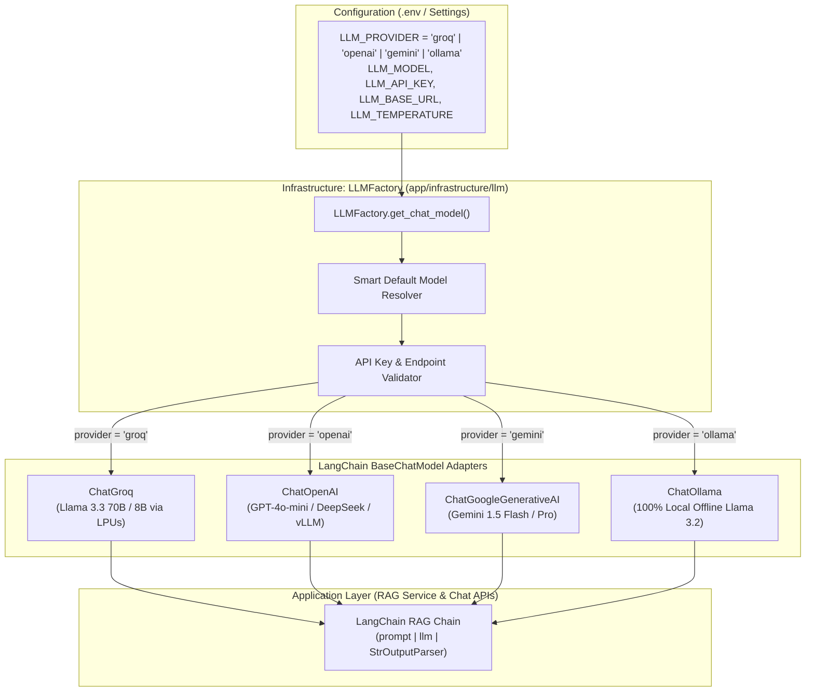
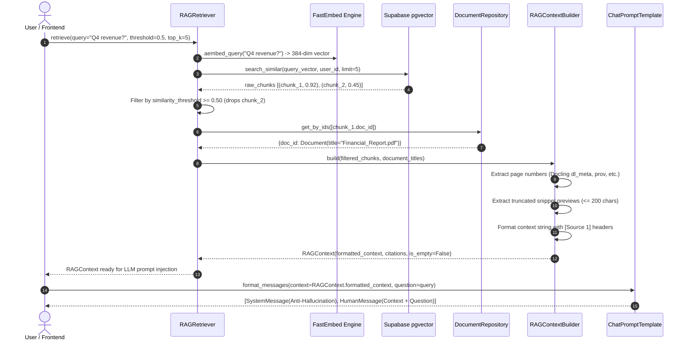
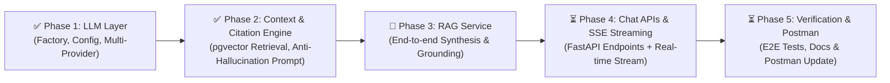

# Chapter 07: Pluggable LLM Architecture & RAG Generation

This guide documents the design, architecture, and configuration of the platform's **Pluggable LLM Infrastructure Layer** (`app/infrastructure/llm/`). 

It details how the platform integrates with LangChain to provide vendor-agnostic chat models, smart default resolution, zero-cost development paths, and strict error handling.

---

## 🧭 Navigation
[← Documentation Blueprint](./README.md) | [← Previous: 06 — Semantic Search & APIs](./06_semantic_search_and_api_guide.md)

---

## 1. Architectural Motivation

A production Document Intelligence platform must **never hardcode or couple its business logic to a single AI vendor**. 

Vendor lock-in creates serious operational risks:
1. **Cost Volatility:** Commercial APIs frequently change pricing tiers and token quotas.
2. **Rate Limits & Outages:** A single provider downtime could halt enterprise document processing.
3. **Data Privacy & Compliance:** Regulated industries (healthcare, finance) often require 100% on-premises offline models (e.g., via Ollama), while public SaaS users prefer ultra-fast cloud models (e.g., Groq or Google Gemini).

To solve this, the platform isolates all LLM interactions behind a unified **Factory Pattern** (`LLMFactory`) powered by **LangChain's `BaseChatModel` abstraction**.



---

## 2. Supported LLM Providers & Smart Defaults

The platform includes first-class support for 4 major provider ecosystems. If `LLM_MODEL` is not specified, `LLMFactory` automatically selects the best production-grade model for that provider:

| Provider (`LLM_PROVIDER`) | Adapter Class | Smart Default Model | Best For | Cost Tier |
| :--- | :--- | :--- | :--- | :--- |
| **`groq`** | `ChatGroq` | `llama-3.3-70b-versatile` | Ultra-fast RAG generation (500+ tokens/sec) | **100% Free** (No credit card needed) |
| **`gemini`** / **`google`** | `ChatGoogleGenerativeAI` | `gemini-1.5-flash` | Long context windows & multi-modal RAG | **100% Free** (No credit card needed) |
| **`ollama`** | `ChatOllama` | `llama3.2` | 100% private, on-premise, offline execution | **100% Free** (Runs on local CPU/GPU) |
| **`openai`** | `ChatOpenAI` | `gpt-4o-mini` | Commercial cloud standard & custom proxies | Paid (or custom third-party endpoint) |

> [!NOTE]
> Because `ChatOpenAI` supports the `base_url` parameter, you can point `LLM_PROVIDER=openai` to **any OpenAI-compatible proxy** (such as DeepSeek, Together AI, OpenRouter, or a local vLLM instance) simply by configuring `LLM_BASE_URL`.

---

## 3. Zero-Cost Setup Guide (No Credit Card Required)

For development, testing, and production bootstrapping, the platform is designed to run with **zero API costs**.

### Option A: Groq Cloud (Recommended Default)
Groq provides free cloud access to Meta's flagship open-weights models running on custom LPU (Language Processing Unit) chips.
1. Sign up at **[https://console.groq.com/](https://console.groq.com/)** using Google or GitHub.
2. In the left sidebar, click **API Keys** $\rightarrow$ **Create API Key**.
3. Copy the key (starts with `gsk_...`).
4. Update your `.env`:
   ```bash
   LLM_PROVIDER=groq
   LLM_MODEL=llama-3.3-70b-versatile
   LLM_API_KEY=gsk_your_groq_key_here
   ```
* **Quota:** ~30 requests/minute, 14,400 requests/day (Free tier).

---

### Option B: Google AI Studio (Gemini 1.5 Flash)
Google AI Studio offers a free API quota with high rate limits.
1. Sign up at **[https://aistudio.google.com/](https://aistudio.google.com/)** with your Google account.
2. Click **Get API key** in the left menu $\rightarrow$ **Create API Key**.
3. Copy the key (starts with `AIzaSy...`).
4. Update your `.env`:
   ```bash
   LLM_PROVIDER=gemini
   LLM_MODEL=gemini-1.5-flash
   LLM_API_KEY=AIzaSy_your_gemini_key_here
   ```
* **Quota:** 15 requests/minute, 1,500 requests/day (Free tier).

---

### Option C: Ollama (100% Offline, Zero Keys, Unlimited)
If you need zero external network dependencies and absolute data privacy:
1. Download Ollama from **[https://ollama.com/](https://ollama.com/)**.
2. Run in terminal: `ollama run llama3.2`
3. Update your `.env`:
   ```bash
   LLM_PROVIDER=ollama
   LLM_MODEL=llama3.2
   LLM_API_KEY=
   LLM_BASE_URL=http://localhost:11434
   ```
* **Quota:** Unlimited. 100% offline.

---

## 4. Code Architecture (`app/infrastructure/llm/`)

The LLM subsystem mirrors the established structure of [`app/infrastructure/storage/`](../app/infrastructure/storage/):

```
app/infrastructure/llm/
├── __init__.py       # Exports LLMFactory, get_llm, and exception classes
├── exceptions.py     # Custom domain exceptions (LLMConfigurationError, LLMGenerationError)
└── factory.py        # LLMFactory with smart defaults and provider instantiation
```

### Factory Implementation (`factory.py`):
```python
class LLMFactory:
    @staticmethod
    def get_chat_model(
        provider: str | None = None,
        model: str | None = None,
        api_key: str | None = None,
        base_url: str | None = None,
        temperature: float | None = None,
        max_tokens: int | None = None,
        **kwargs: Any,
    ) -> BaseChatModel:
        resolved_provider = (provider or settings.LLM_PROVIDER).strip().lower()

        # Smart default resolution
        if model:
            resolved_model = model
        elif resolved_provider == settings.LLM_PROVIDER.strip().lower() and settings.LLM_MODEL:
            resolved_model = settings.LLM_MODEL
        else:
            resolved_model = DEFAULT_PROVIDER_MODELS.get(resolved_provider, "gpt-4o-mini")

        ...
```

### Exception Hierarchy (`exceptions.py`):
* **`LLMConfigurationError` (`HTTP 500`):**
  Raised if a provider requires an API key that was not supplied, or if an unsupported provider string is passed.
* **`LLMGenerationError` (`HTTP 502`):**
  Raised if upstream model inference fails due to remote network disruptions, rate limits, or context window overflow.

---

## 5. Configuration Reference Matrix

All LLM behavior is managed via environment variables in `.env` and typed in [`app/core/config.py`](../app/core/config.py):

| Variable | Type | Default | Description |
| :--- | :--- | :--- | :--- |
| `LLM_PROVIDER` | `string` | `"groq"` | Active provider: `"groq"`, `"openai"`, `"gemini"`, `"ollama"`. |
| `LLM_MODEL` | `string` | `"llama-3.3-70b-versatile"` | Specific model name. Falls back to provider default if empty. |
| `LLM_API_KEY` | `string` | `""` | API Key for the active provider (starts with `gsk_`, `sk-`, `AIzaSy`). |
| `LLM_BASE_URL` | `string` | `None` | Custom endpoint URL (e.g. `http://localhost:11434` for Ollama). |
| `LLM_TEMPERATURE` | `float` | `0.1` | Sampling temperature ($0.0$ to $1.0$). Kept low for factual RAG answers. |
| `LLM_MAX_TOKENS` | `integer` | `2048` | Maximum output tokens generated per answer. |

---

## 6. Phase 2: RAG Context Retrieval & Citation Formatting Engine (`app/modules/chat/`)

Phase 2 builds the core bridge between raw vector database chunks and the LLM generation prompt:

```
app/modules/chat/
├── __init__.py       # Exports public schemas, context builder, retriever, and prompt templates
├── schemas.py        # CitationSource, RAGContext, ChatQueryRequest, ChatQueryResponse
├── prompts.py        # Strict anti-hallucination system prompt & LangChain ChatPromptTemplate
├── context.py        # RAGContextBuilder (page extraction, snippet preview, [Source N] headers)
└── retriever.py      # RAGRetriever (vector search, threshold filtering, batch title resolution)
```



### 1. Structured Citation Schema (`schemas.py`)
Each retrieved chunk is parsed into a frontend-ready `CitationSource` model:
```json
{
  "source_number": 1,
  "document_id": "a1b2c3d4-e5f6-7890-abcd-ef1234567890",
  "document_title": "Financial_Report.pdf",
  "chunk_id": "chunk_9999",
  "chunk_index": 4,
  "page_number": 12,
  "snippet": "In Q4, overall recurring SaaS revenue grew by 14% year-over-year to $1.2B...",
  "similarity": 0.9123
}
```

### 2. Multi-Format Page Number Extraction (`context.py`)
Because documents are parsed through IBM Docling (and potentially other fallback parsers), metadata schemas differ. `RAGContextBuilder.extract_page_number` resolves page numbers across:
* Docling `dl_meta.pages` (handles single pages e.g. `12` or page ranges e.g. `"12-13"`)
* Docling provenance arrays: `prov[0].page_no`
* Standard flat keys: `page_number`, `page`, `page_no`, `page_idx` (0-indexed converted to 1-indexed)

### 3. Strict Anti-Hallucination Prompt Template (`prompts.py`)
The system prompt enforces three critical guardrails:
1. **Grounding Only:** The model is forbidden from using outside knowledge or assuming facts.
2. **Explicit Fallback:** If the retrieved text lacks the answer, the model must output:
   `"I cannot find the answer to this question in the provided documents."`
3. **Mandatory Citations:** Every single fact or statistic must cite its source tag (e.g. `[Source 1]`, `[Source 2]`).

```python
# Format messages cleanly using LangChain
prompt_template = get_rag_prompt_template()
messages = prompt_template.format_messages(
    context=rag_context.formatted_context,
    question=user_question,
)
```

### 4. Efficient Batch Retrieval & Filtering (`retriever.py`)
* **Similarity Thresholding:** Users can specify `similarity_threshold` (e.g. `0.60`). Any chunks scoring below this threshold are discarded before reaching the prompt, saving tokens and eliminating irrelevant noise.
* **Batch Title Resolution:** Solves the N+1 query problem by batch-fetching all distinct `document_id`s in a single SQL query (`DocumentRepository.get_by_ids`).

---

## 7. Roadmap & Progress Matrix



* **Phase 1 (Completed):** Multi-provider LLM Factory (`ChatGroq`, `ChatOpenAI`, `ChatGoogleGenerativeAI`, `ChatOllama`) with smart model defaults.
* **Phase 2 (Completed):** `RAGRetriever`, `RAGContextBuilder`, page extraction, and LangChain `ChatPromptTemplate` with anti-hallucination directives.
* **Phase 3 (Next):** Orchestrate `RAGService` integrating retrieval, prompt execution, and citation resolution.
* **Phase 4:** FastAPI chat endpoints (`POST /documents/chat`, `POST /documents/{id}/chat`) with Server-Sent Events (SSE) streaming.
* **Phase 5:** End-to-end testing, Postman collection update, and documentation wrap-up.

---

### Navigation
[← Previous: 06 — Semantic Search & APIs](./06_semantic_search_and_api_guide.md) | [Documentation Blueprint](./README.md)
