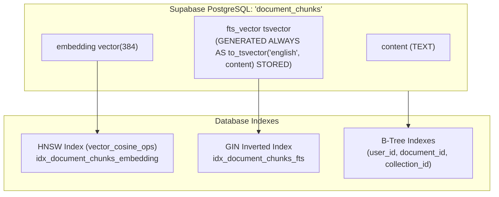
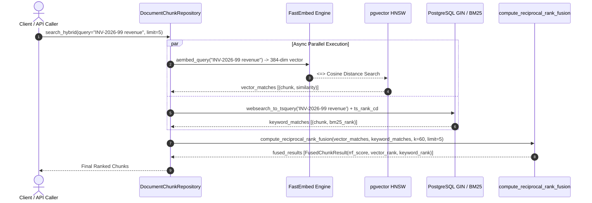

# Chapter 08: Supabase Hybrid Search & Reciprocal Rank Fusion (RRF)

This guide provides an exhaustive technical analysis of the platform's **Hybrid Search Subsystem**, detailing the combination of **Dense Semantic Vector Search** (Supabase `pgvector` HNSW) and **Sparse Full-Text Search** (PostgreSQL `tsvector` + GIN), unified by the **Reciprocal Rank Fusion (RRF)** reranking algorithm.

---

## 🧭 Navigation
[← Documentation Blueprint](./README.md) | [← Previous: 07 — LLM & RAG Orchestration](./07_llm_and_rag_orchestration.md)

---

## 1. Architectural Motivation: Why Hybrid Search?

In enterprise document intelligence, neither vector search nor keyword search alone is sufficient:

```
┌──────────────────────────────────────┐     ┌──────────────────────────────────────┐
│       Dense Vector Search (HNSW)     │     │       Sparse Keyword Search (BM25)   │
├──────────────────────────────────────┤     ├──────────────────────────────────────┤
│ ✅ Semantic synonyms & meaning       │     │ ❌ Zero understanding of synonyms    │
│    ("revenue growth" -> "sales rose")│     │    ("car" will not match "automobile")│
│ ❌ Fails on exact codes & jargon     │     │ ✅ Exact alphanumeric match          │
│    ("INV-2026-99", "Clause 4.1.2")   │     │    ("INV-2026-99", "CVE-2024-38077") │
│ ❌ Out-of-vocabulary blurring        │     │ ✅ Proper nouns & exact acronyms     │
└──────────────────┬───────────────────┘     └──────────────────┬───────────────────┘
                   │                                            │
                   └─────────────────────┬──────────────────────┘
                                         ▼
                   ┌───────────────────────────────────────────┐
                   │   Reciprocal Rank Fusion (RRF Engine)     │
                   │   Combines the best of both worlds        │
                   └───────────────────────────────────────────┘
```

1. **The Vocabulary Mismatch Problem:** Users searching for legal contract clauses or invoice numbers (e.g. `"Section 14.2(b)"`, `"INV-88301"`) frequently get irrelevant results from vector search because dense embedding models compress specific alphanumeric tokens into abstract semantic neighborhoods.
2. **The Synonym Problem:** Traditional full-text search fails when users ask natural questions using different terminology (e.g., asking for *"firm termination compensation"* when the document says *"severance package"*).
3. **The Hybrid Solution:** Run dense vector search and sparse full-text search in parallel, then merge the candidate pools using **Reciprocal Rank Fusion (RRF)**.

---

## 2. The Mathematics of Reciprocal Rank Fusion (RRF)

### The Scale Incompatibility Problem
Vector cosine similarity produces scores between $0.0$ and $1.0$, while PostgreSQL BM25 full-text search (`ts_rank_cd`) produces arbitrary positive floats (e.g. $0.012$ to $18.5$). **You cannot directly add or multiply these scores together** because their distributions, variances, and scales are fundamentally incompatible.

### The RRF Solution
Proposed by Cormack, Clarke, and Büttcher (SIGIR 2009), **Reciprocal Rank Fusion** discards arbitrary score magnitudes and operates strictly on **rank positions** ($1^{\text{st}}, 2^{\text{nd}}, 3^{\text{rd}}, \dots$):

$$\text{RRF\_Score}(d) = \sum_{m \in M} \frac{1}{k + r_m(d)}$$

Where:
* $d$ is a candidate document chunk.
* $M$ is the set of search systems (here, $M = \{\text{vector}, \text{keyword}\}$).
* $r_m(d)$ is the 1-indexed rank position of document $d$ in search system $m$. If document $d$ does not appear in system $m$'s top candidates, its term evaluates to $0$.
* $k$ is a smoothing constant (standard default: $k = 60$). The constant $k$ ensures that the difference between rank 1 and rank 2 is meaningful, while preventing outliers from skewing the final list.

### Concrete Blending Example ($k = 60$):

| Chunk | Vector Rank | Keyword Rank | Calculation | RRF Score | Result |
| :--- | :---: | :---: | :--- | :---: | :--- |
| **Chunk A** | #1 | #1 | $\frac{1}{60+1} + \frac{1}{60+1} = \frac{1}{61} + \frac{1}{61}$ | **$0.032787$** | **Rank 1** (Strong in both) |
| **Chunk B** | #3 | #2 | $\frac{1}{60+3} + \frac{1}{60+2} = \frac{1}{63} + \frac{1}{62}$ | **$0.032002$** | **Rank 2** (Boosted by dual presence) |
| **Chunk C** | #2 | *Not in top* | $\frac{1}{60+2} + 0 = \frac{1}{62}$ | **$0.016129$** | **Rank 3** (Vector only) |
| **Chunk D** | *Not in top* | #3 | $0 + \frac{1}{60+3} = \frac{1}{63}$ | **$0.015873$** | **Rank 4** (Keyword only) |

> [!NOTE]
> Notice how **Chunk B** (rank 3 in vector, rank 2 in keyword) ranks higher than **Chunk C** (rank 2 in vector). RRF rewards consensus across multiple retrieval mechanisms.

---

## 3. Database Architecture: GIN Indexes & Generated `tsvector`

To ensure full-text search operates at sub-millisecond speeds over millions of chunks, the platform introduces a dedicated **GIN (Generalized Inverted Index)** in PostgreSQL via Alembic migration `f4a8b1c2d3e4`:



### PostgreSQL DDL (`f4a8b1c2d3e4_add_fts_and_gin_index_to_document_chunks.py`):
```sql
-- 1. Generated column updated automatically upon row insert/update
ALTER TABLE document_chunks 
ADD COLUMN IF NOT EXISTS fts_vector tsvector 
GENERATED ALWAYS AS (to_tsvector('english', coalesce(content, ''))) STORED;

-- 2. GIN Index for fast full-text evaluation
CREATE INDEX IF NOT EXISTS idx_document_chunks_fts 
ON document_chunks USING gin (fts_vector);
```

### Query Engine: `websearch_to_tsquery`
The platform uses PostgreSQL's `websearch_to_tsquery('english', query)`:
* Handles natural human search patterns.
* Supports exact phrases with double quotes (e.g. `"Clause 14.2"`).
* Supports negative exclusions with minus (e.g. `revenue -expenses`).
* **Never throws syntax errors** when users enter punctuation, special characters, or unclosed quotes.

---

## 4. Parallel Query Execution (`asyncio.gather`)

Hybrid search queries both systems concurrently to minimize latency:



---

## 5. API Reference: Search Endpoint (`POST /documents/search`)

### Request Schema (`ChunkSearchRequest`):
| Field | Type | Default | Description |
| :--- | :--- | :--- | :--- |
| `query` | `string` | *Required* | Natural language query, code, or keyword phrase. |
| `mode` | `string` | `"hybrid"` | Search algorithm: `"hybrid"` (RRF), `"vector"` (cosine only), or `"keyword"` (BM25 only). |
| `limit` | `integer` | `5` | Maximum number of chunks to return ($1$ to $50$). |
| `collection_id`| `string` | `null` | Optional UUID to scope search within a specific collection. |
| `document_id` | `string` | `null` | Optional UUID to scope search to a single document. |
| `similarity_threshold` | `float` | `0.0` | Minimum score threshold ($0.0$ to $1.0$). |

---

### Example 1: Hybrid Search Request (`mode="hybrid"`)

**Request:**
```http
POST /documents/search
Content-Type: application/json
Authorization: Bearer {{access_token}}

{
  "query": "What are the termination penalties in Clause 14.2?",
  "mode": "hybrid",
  "limit": 3
}
```

**Response (`HTTP 200 OK`):**
```json
{
  "success": true,
  "message": "Found 3 matching chunk(s) using hybrid search",
  "data": [
    {
      "id": "chunk_a1b2c3",
      "document_id": "doc_9999",
      "collection_id": "col_1111",
      "content": "Clause 14.2 (Termination Penalties): In the event of early termination without cause, the client shall pay 50% of the remaining contract balance...",
      "metadata": {
        "page_number": 8,
        "original_filename": "Service_Agreement.pdf"
      },
      "similarity": 0.0328,
      "search_mode": "hybrid",
      "vector_rank": 1,
      "keyword_rank": 1,
      "rrf_score": 0.0328
    },
    {
      "id": "chunk_d4e5f6",
      "document_id": "doc_9999",
      "collection_id": "col_1111",
      "content": "Section 14: General Provisions and Default Remedies applicable to contract disputes...",
      "metadata": {
        "page_number": 7,
        "original_filename": "Service_Agreement.pdf"
      },
      "similarity": 0.0161,
      "search_mode": "hybrid",
      "vector_rank": 2,
      "keyword_rank": null,
      "rrf_score": 0.0161
    }
  ]
}
```

---

### Example 2: Exact Keyword Search Request (`mode="keyword"`)

**Request:**
```http
POST /documents/search
Content-Type: application/json
Authorization: Bearer {{access_token}}

{
  "query": "INV-2026-99",
  "mode": "keyword",
  "limit": 5
}
```

**Response (`HTTP 200 OK`):**
```json
{
  "success": true,
  "message": "Found 1 matching chunk(s) using keyword search",
  "data": [
    {
      "id": "chunk_7777",
      "document_id": "doc_3333",
      "collection_id": null,
      "content": "Invoice Reference: INV-2026-99 | Date: October 14, 2026 | Total Due: $45,000.00",
      "metadata": {
        "page_number": 1,
        "original_filename": "Vendor_Invoice_Oct.pdf"
      },
      "similarity": 4.2514,
      "search_mode": "keyword",
      "vector_rank": null,
      "keyword_rank": null,
      "rrf_score": null
    }
  ]
}
```

---

## 6. Integration with Document Chat & RAG Engine

Hybrid search is deeply integrated into the RAG Question Answering pipeline:
1. **`ChatQueryRequest` and `SingleDocumentChatRequest`** now accept `search_mode: "hybrid" | "vector" | "keyword"` (defaulting to `"hybrid"`).
2. **`RAGRetriever`** automatically retrieves context chunks using the fused RRF ranking.
3. This guarantees that when users ask specific questions containing exact document numbers or terminology in `POST /documents/chat`, the model receives the exact corresponding excerpt as `[Source 1]`.

---

### Navigation
[← Previous: 07 — LLM & RAG Orchestration](./07_llm_and_rag_orchestration.md) | [Documentation Blueprint](./README.md)
