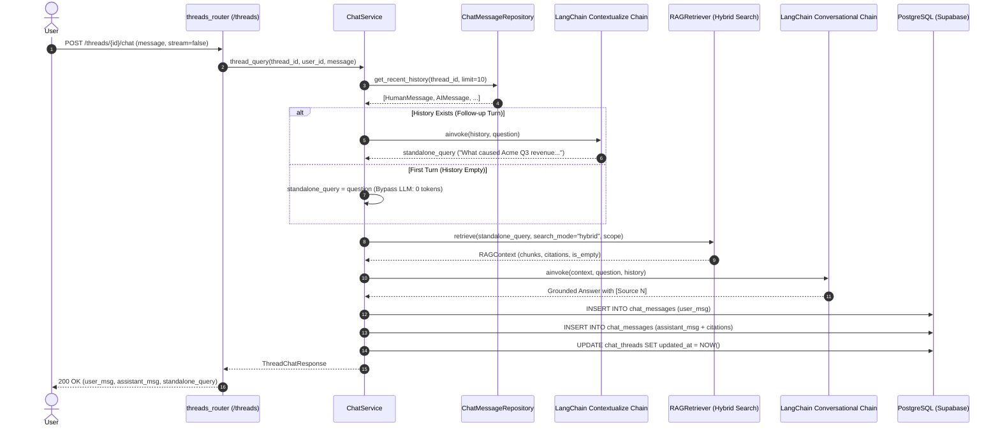

# Chapter 09: Conversational Memory & Multi-Turn Chat Threads

This guide provides an exhaustive architectural and implementation analysis of the platform's **Conversational Memory & Chat Threads Subsystem**, detailing persistent chat thread lifecycle management, LangChain-based conversational query condensation, multi-turn grounded RAG synthesis, and real-time Server-Sent Events (SSE) streaming.

---

## 🧭 Navigation
[← Documentation Blueprint](./README.md) | [← Previous: 08 — Hybrid Search & RRF](./08_hybrid_search_and_rrf.md)

---

## 1. Architectural Motivation: From Stateless RAG to Conversational Threads

Single-turn RAG (`POST /documents/chat`) treats every incoming question as an isolated, stateless event. In real-world enterprise document research, user workflows are naturally conversational and iterative:

```
Turn 1: "What was Acme Corp's total revenue in Q3 2024?"
Assistant: "Acme Corp reported $15.4M in Q3 2024 [Source 1]."

Turn 2: "What were the primary factors behind that increase?"
Assistant (without memory): ❌ "I cannot find any relevant information to answer this question."
(Search failed because "that increase" does not mention Acme Corp, Q3 2024, or revenue!)

Assistant (with Conversational Memory): ✅
Contextualizer translates: "What factors contributed to Acme Corp's Q3 2024 revenue growth?"
Retriever fetches: Chunks discussing enterprise customer expansions.
Synthesizer answers: "The revenue growth was driven by a 40% expansion in enterprise subscriptions [Source 2]."
```

### Key Engineering Challenges Solved:
1. **Pronoun & Ellipsis Resolution (The Vocabulary Gap):** Follow-up questions (*"Why?"*, *"Can you explain clause 3.2?"*, *"Compare that to 2023"*) lack search keywords. A contextualization prompt reformulates the follow-up question into a standalone semantic query before passing to the hybrid search engine.
2. **Context Window Management:** Unbounded conversation history causes token inflation, latency spikes, and LLM context window overflows. We enforce a sliding window ($N=10$ recent messages) combined with prompt templates utilizing `MessagesPlaceholder`.
3. **Thread-Scoped Knowledge Isolation:** Chat threads can be optionally scoped to a specific `collection_id` or `document_id`, restricting search retrieval to that workspace.
4. **Deterministic Auditability:** Every turn persists the exact user input, reformulated standalone query, assistant answer, model metadata, latency, and full citation cards (document ID, filename, page number, chunk index, text snippet, similarity score).

---

## 2. System Architecture & End-to-End Flow



---

## 3. Database Schema & Data Modeling

The subsystem introduces two relational tables backed by PostgreSQL with foreign key constraints, indexes, and soft-delete capabilities:

```
┌────────────────────────────────────────────────────────┐
│                      chat_threads                      │
├───────────────────┬──────────────┬─────────────────────┤
│ id                │ VARCHAR(36)  │ PRIMARY KEY         │
│ user_id           │ VARCHAR(36)  │ FK -> users.id      │
│ title             │ VARCHAR(255) │ Default title       │
│ collection_id     │ VARCHAR(36)  │ FK -> collections.id│
│ document_id       │ VARCHAR(36)  │ FK -> documents.id  │
│ created_at        │ TIMESTAMPTZ  │ UTC creation        │
│ updated_at        │ TIMESTAMPTZ  │ Last activity       │
│ deleted_at        │ TIMESTAMPTZ  │ Soft-delete audit   │
└───────────────────┴──────────────┴─────────────────────┘
                               ▲ 1
                               │
                               │ has many
                               ▼ N
┌────────────────────────────────────────────────────────┐
│                     chat_messages                      │
├───────────────────┬──────────────┬─────────────────────┤
│ id                │ VARCHAR(36)  │ PRIMARY KEY         │
│ thread_id         │ VARCHAR(36)  │ FK -> threads.id    │
│ role              │ VARCHAR(20)  │ 'user' | 'assistant'│
│ content           │ TEXT         │ Full message text   │
│ citations         │ JSON         │ Array of Citations  │
│ model             │ VARCHAR(100) │ LLM model used      │
│ provider          │ VARCHAR(50)  │ LLM provider used   │
│ execution_time_ms │ FLOAT        │ Latency in ms       │
│ created_at        │ TIMESTAMPTZ  │ UTC timestamp       │
└───────────────────┴──────────────┴─────────────────────┘
```

### Alembic Migration (`b7e3c1a9d5f2_create_chat_threads_and_messages.py`)
```sql
CREATE TABLE chat_threads (
    id VARCHAR(36) NOT NULL PRIMARY KEY,
    user_id VARCHAR NOT NULL REFERENCES users(id) ON DELETE CASCADE,
    title VARCHAR(255) NOT NULL,
    collection_id VARCHAR REFERENCES collections(id) ON DELETE SET NULL,
    document_id VARCHAR REFERENCES documents(id) ON DELETE SET NULL,
    created_at TIMESTAMPTZ NOT NULL,
    updated_at TIMESTAMPTZ NOT NULL,
    deleted_at TIMESTAMPTZ
);

CREATE INDEX ix_chat_threads_user_id ON chat_threads(user_id);
CREATE INDEX ix_chat_threads_collection_id ON chat_threads(collection_id);
CREATE INDEX ix_chat_threads_document_id ON chat_threads(document_id);

CREATE TABLE chat_messages (
    id VARCHAR(36) NOT NULL PRIMARY KEY,
    thread_id VARCHAR(36) NOT NULL REFERENCES chat_threads(id) ON DELETE CASCADE,
    role VARCHAR(20) NOT NULL,
    content TEXT NOT NULL,
    citations JSON,
    model VARCHAR(100),
    provider VARCHAR(50),
    execution_time_ms FLOAT,
    created_at TIMESTAMPTZ NOT NULL
);

CREATE INDEX ix_chat_messages_thread_id ON chat_messages(thread_id);
CREATE INDEX ix_chat_messages_thread_created ON chat_messages(thread_id, created_at);
```

---

## 4. LangChain LCEL Conversational Pipeline

### 4.1. Query Contextualization Prompt (`prompts.py`)
```python
CONTEXTUALIZE_Q_SYSTEM_PROMPT = """Given a chat history and the latest user question \
which might reference context in the chat history, formulate a standalone question \
which can be understood without the chat history. Do NOT answer the question, \
just reformulate it if needed and otherwise return it as is."""

contextualize_prompt = ChatPromptTemplate.from_messages([
    ("system", CONTEXTUALIZE_Q_SYSTEM_PROMPT),
    MessagesPlaceholder(variable_name="chat_history"),
    ("human", "{question}"),
])

contextualize_chain = contextualize_prompt | llm | StrOutputParser()
```

### 4.2. Conversational Anti-Hallucination QA Prompt (`prompts.py`)
```python
conversational_rag_prompt = ChatPromptTemplate.from_messages([
    ("system", RAG_SYSTEM_PROMPT),
    MessagesPlaceholder(variable_name="chat_history"),
    ("human", RAG_HUMAN_PROMPT),  # Accepts {context} and {question}
])

conversational_chain = conversational_rag_prompt | llm | StrOutputParser()
```

### 4.3. Performance & Token Optimizations:
1. **First-Turn Contextualization Bypass:** If a thread has $0$ prior messages, the contextualization chain is completely bypassed:
   $$\text{standalone\_query} = \text{user\_input}$$
   This saves an entire LLM inference call (~500ms) and $0$ contextualization tokens on every new discussion.
2. **Empty Context Fast-Exit:** If hybrid search finds no chunks above `similarity_threshold`, `ChatService` emits the fallback answer (`"I cannot find any relevant information..."`), bypassing generation, consuming $0$ LLM tokens, and persisting the turn in $< 15\text{ms}$.
3. **Sliding Memory Window:** The service requests only the last $N=10$ messages (`limit=10`) ordered chronologically, ensuring predictable token usage regardless of thread length.

---

## 5. Dual Execution: Batch & Real-Time SSE Streaming

### 5.1. Batch Execution (`stream=false`)
Submits a conversational turn and receives a single JSON envelope with:
- Persisted user message with UUID and UTC timestamp.
- Persisted assistant message with citations, model name, provider, and execution latency.
- Reformulated `standalone_query` (or `null` if identical to user input).

### 5.2. Streaming Execution (`stream=true`)
Streams real-time tokens over standard W3C Server-Sent Events (`text/event-stream`):
1. **`metadata` event:** Emitted first with the user message ID, standalone query, and full citation cards.
2. **`token` events:** Emitted word-by-word as generated by the LLM.
3. **`done` event:** Emitted once complete with assistant message ID and total execution time.

```http
HTTP/1.1 200 OK
Content-Type: text/event-stream; charset=utf-8
Cache-Control: no-cache
Connection: keep-alive
X-Accel-Buffering: no

event: metadata
data: {"thread_id": "th_123", "user_message_id": "msg_u1", "question": "Why?", "standalone_query": "Why did Q3 profit drop?", "citations": [...], "model": "llama-3.3-70b-versatile", "provider": "groq"}

event: token
data: {"token": "The "}

event: token
data: {"token": "profit "}

event: token
data: {"token": "dropped "}

event: done
data: {"assistant_message_id": "msg_a1", "execution_time_ms": 412.3}
```

---

## 6. API Reference: Thread Endpoints

| Method | Endpoint | Description |
| :--- | :--- | :--- |
| `POST` | `/threads` | Creates a new conversation thread (optional collection/document scope). |
| `GET` | `/threads` | Lists user conversation threads (paginated, ordered by `updated_at DESC`). |
| `GET` | `/threads/{thread_id}` | Retrieves full thread details and chronological message history. |
| `PATCH` | `/threads/{thread_id}` | Renames a conversation thread title. |
| `DELETE`| `/threads/{thread_id}` | Soft-deletes a thread and archives its history. |
| `POST` | `/threads/{thread_id}/chat` | Multi-turn conversational chat (batch JSON or SSE stream). |
| `GET` | `/threads/{thread_id}/messages` | Paginated chronological message history for a thread. |

---

## 7. Verification & Test Coverage

The subsystem has been verified end-to-end:

* ✅ **Test 1 (Thread CRUD):** Verifies thread creation (`201 Created`), pagination (`GET /threads`), message history retrieval (`GET /threads/{id}`), renaming (`PATCH /threads/{id}`), and soft deletion (`DELETE /threads/{id}`).
* ✅ **Test 2 (Query Reformulation & Grounding):** Verifies multi-turn memory flow: passes history, reformulates *"Why did that happen?"* into standalone semantic query, passes query to hybrid retriever with collection scoping, generates grounded response, and saves both user and assistant messages with citations.
* ✅ **Test 3 (First-Turn Optimization):** Verifies that when a thread is empty, the contextualization chain is bypassed (zero token overhead).
* ✅ **Test 4 (Conversational SSE Streaming):** Verifies real-time Server-Sent Events headers, `metadata` emission, token chunks, and `done` event.
