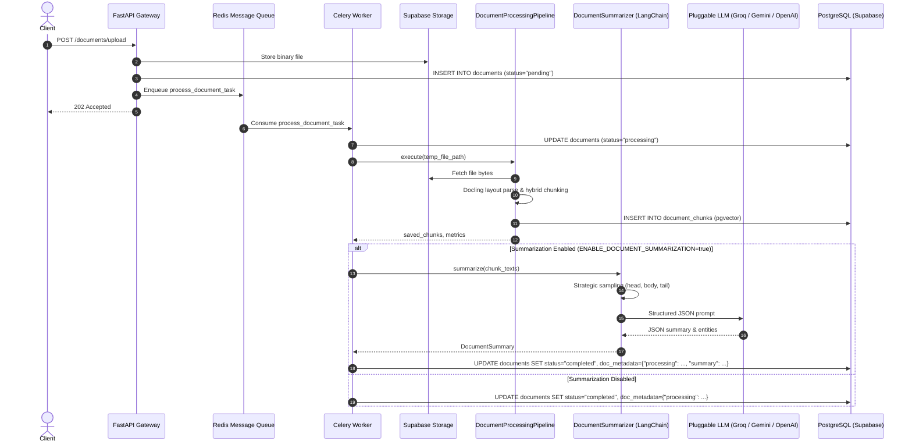

# Chapter 10: Automated Document Summarization & Entity Extraction (in Celery)

This guide provides an exhaustive architectural and implementation analysis of the platform's **Automated Document Summarization & Entity Extraction Subsystem**, detailing its distributed Celery worker execution, strategic chunk sampling for large documents, JSON schema enforcement, entity catalog extraction, and on-demand REST APIs.

---

## 🧭 Navigation
[← Documentation Blueprint](./README.md) | [← Previous: 09 — Conversational Threads & Memory](./09_conversational_threads_and_memory.md)

---

## 1. Architectural Motivation: The "Cold Start" Document Problem

When users upload large business documents, legal contracts, or technical reports, dense vector embedding and chunking prepare the document for search, but users face a **cold-start intelligence gap**:
* Users do not yet know what queries to ask.
* Reading 50-page PDFs or 200 chunk snippets manually is slow and inefficient.
* Critical business metadata (who signed the contract, when does it expire, what is the contract value, what is the document type) remains buried inside unstructured paragraphs.

```
┌────────────────────────────────────────────────────────┐
│               Traditional Ingestion Pipeline           │
├────────────────────────────────────────────────────────┤
│  Upload -> Parse -> Chunk -> Embed -> Index Chunks    │
│  ❌ Result: User must manually search or read pages    │
└────────────────────────────────────────────────────────┘

┌────────────────────────────────────────────────────────┐
│          Autonomous Document Intelligence Pipeline     │
├────────────────────────────────────────────────────────┤
│  Upload -> Parse -> Chunk -> Embed -> Index Chunks     │
│                                 │                      │
│                                 ▼                      │
│        [Autonomous Document Summarizer in Celery]      │
│        • Executive Summary (2-3 paragraphs)            │
│        • 3-5 Key Actionable Highlights                 │
│        • Structured Entity Catalog:                    │
│          - Parties: Acme Corp, TechGlobal LLC          │
│          - Dates: Oct 1, 2026, Sep 30, 2029            │
│          - Financials: $5,000,000 total value          │
│          - Classification: Master Services Agreement   │
│          - Topics: Enterprise SaaS, Cloud, SLA         │
│                                 │                      │
│                                 ▼                      │
│        Persisted in: Document.doc_metadata["summary"]  │
│  ✅ Result: Instant 1-second executive overview        │
└────────────────────────────────────────────────────────┘
```

---

## 2. Distributed Celery Worker Integration Architecture

Document summarization executes as an integrated stage within the **asynchronous Celery worker process**, ensuring web requests return immediately with `HTTP 202 Accepted` while heavy layout parsing and LLM summarization happen in the background:



---

## 3. Structured Data Model & Entity Catalog

The summary and extracted entities are defined as Pydantic models in [`app/modules/processing/summarizer/schemas.py`](file:///D:/Code/Projects/ai-document-intelligence-platform/app/modules/processing/summarizer/schemas.py) and persisted as JSON in PostgreSQL `documents.doc_metadata["summary"]`:

### Extracted Entity Categories:
1. **`parties` (`list[str]`):** Companies, organizations, authors, signatories, government bodies, or key individuals (e.g. `["Acme Corp", "TechGlobal LLC", "John Doe (VP Engineering)"]`).
2. **`dates` (`list[str]`):** Effective dates, expiration deadlines, fiscal quarters, or milestone dates (e.g. `["October 1, 2026", "Q4 2025", "September 30, 2029"]`).
3. **`monetary_amounts` (`list[str]`):** Financial numbers, pricing, annual fees, penalties, or compensation figures (e.g. `["$5,000,000 total", "$10,000 monthly maintenance", "15% late penalty"]`).
4. **`document_type` (`str`):** Classification category (e.g. `"Master Services Agreement"`, `"Quarterly Financial Statement"`, `"Vendor Invoice"`, `"Employment Agreement"`).
5. **`topics` (`list[str]`):** 3-6 topical keyword tags for automated tagging and categorization (e.g. `["Cloud Migration", "Data Security", "SLA Guarantees"]`).

```json
{
  "executive_summary": "Acme Corp entered into a 3-year Master Services Agreement with TechGlobal LLC to provide enterprise-scale AI cloud analytics and pipeline orchestration. The agreement outlines performance obligations, data privacy standards, and service level guarantees.",
  "key_takeaways": [
    "Three-year term commencing October 1, 2026 through September 30, 2029.",
    "Total contract consideration of $5,000,000 payable in annual milestone installments.",
    "TechGlobal commits to a 99.99% system availability SLA backed by financial credits."
  ],
  "entities": {
    "parties": ["Acme Corp", "TechGlobal LLC"],
    "dates": ["October 1, 2026", "September 30, 2029"],
    "monetary_amounts": ["$5,000,000", "$10,000/month maintenance fee"],
    "document_type": "Master Services Agreement",
    "topics": ["Enterprise SaaS", "SLA Guarantees", "Cloud Analytics", "Data Privacy"]
  },
  "model": "llama-3.3-70b-versatile",
  "provider": "groq",
  "execution_time_ms": 384.2,
  "generated_at": "2026-11-01T23:45:00.000Z"
}
```

---

## 4. Context Window & Strategic Chunk Sampling

Documents can range from 1-page memos to 200-page regulatory filings. Ingesting 200 pages into an LLM call directly risks exceeding token limits, inflating API costs, and triggering rate limits.

The [`DocumentSummarizer`](file:///D:/Code/Projects/ai-document-intelligence-platform/app/modules/processing/summarizer/engine.py#L48-L86) implements an intelligent **Strategic Sampling Engine**:

```
Large Document (100+ chunks, > 30,000 chars)
┌─────────────────────────────────────────────────────────────────────────┐
│ 1. Preamble & Beginning (First 8 chunks)                                │
│    Captures: Title, Parties, Recitals, Effective Dates, Core Objectives │
├─────────────────────────────────────────────────────────────────────────┤
│ 2. Body Representative Sample (6 evenly spaced chunks)                  │
│    Captures: Operational terms, Financial clauses, SLA specs            │
├─────────────────────────────────────────────────────────────────────────┤
│ 3. Execution & Conclusion (Last 4 chunks)                               │
│    Captures: Signatories, Governing Law, Expiration, Disclaimers        │
└─────────────────────────────────────────────────────────────────────────┘
```

* **Documents $\le 30,000$ characters:** Processed completely in full without loss of detail.
* **Documents $> 30,000$ characters:** Strategic sampling compresses the input to the highest-density signal sections while remaining within bounded token budgets.
* **Enterprise Resiliency (Non-Crashing Fallback):** If the LLM provider experiences network timeout or rate limits during summarization, the exception is caught, logged, and a clean fallback metadata object is saved. **The core document parsing, chunking, and pgvector embeddings never fail.**

---

## 5. Dual Execution: Celery Background & On-Demand REST APIs

### 5.1. Background Execution (Celery Task)
Enabled by default via environment configuration:
```env
ENABLE_DOCUMENT_SUMMARIZATION=true
```
When `process_document_task` runs in Celery, summarization occurs automatically after chunk indexing and is committed to `Document.doc_metadata["summary"]`.

### 5.2. On-Demand REST Retrieval (`GET /documents/{id}/summary`)
Returns the pre-generated executive summary and entity catalog:
```http
GET /documents/7c9e6679-7425-40de-944b-e07fc1f90ae7/summary
Authorization: Bearer <access_token>
```
Response:
```json
{
  "message": "Document summary retrieved successfully",
  "data": {
    "document_id": "7c9e6679-7425-40de-944b-e07fc1f90ae7",
    "title": "Master_Services_Agreement.pdf",
    "has_summary": true,
    "summary": {
      "executive_summary": "Acme Corp entered into an enterprise partnership...",
      "key_takeaways": [...],
      "entities": {
        "parties": ["Acme Corp", "TechGlobal LLC"],
        "dates": ["October 1, 2026"],
        "monetary_amounts": ["$5,000,000"],
        "document_type": "Master Services Agreement",
        "topics": ["Enterprise SaaS", "SLA Guarantees"]
      },
      "model": "llama-3.3-70b-versatile",
      "provider": "groq",
      "execution_time_ms": 384.2,
      "generated_at": "2026-11-01T23:45:00.000Z"
    }
  }
}
```

### 5.3. On-Demand Regeneration (`POST /documents/{id}/summarize`)
Allows users to generate or re-generate an executive summary on-demand over existing chunks (e.g. after switching LLM models in settings):
```http
POST /documents/7c9e6679-7425-40de-944b-e07fc1f90ae7/summarize
Authorization: Bearer <access_token>
```

---

## 6. API Reference Summary

| Method | Endpoint | Description |
| :--- | :--- | :--- |
| `GET` | `/documents/{document_id}/summary` | Retrieves the stored executive summary and extracted entity catalog. |
| `POST` | `/documents/{document_id}/summarize` | Generates or regenerates the executive summary on-demand using existing parsed chunks. |
| `POST` | `/documents/{document_id}/process` | Full ingestion pipeline trigger in Celery (chunks, embeddings, vector indexing + auto-summary). |
| `GET` | `/documents/{document_id}` | Full document record including `doc_metadata` with summary and processing metrics. |
