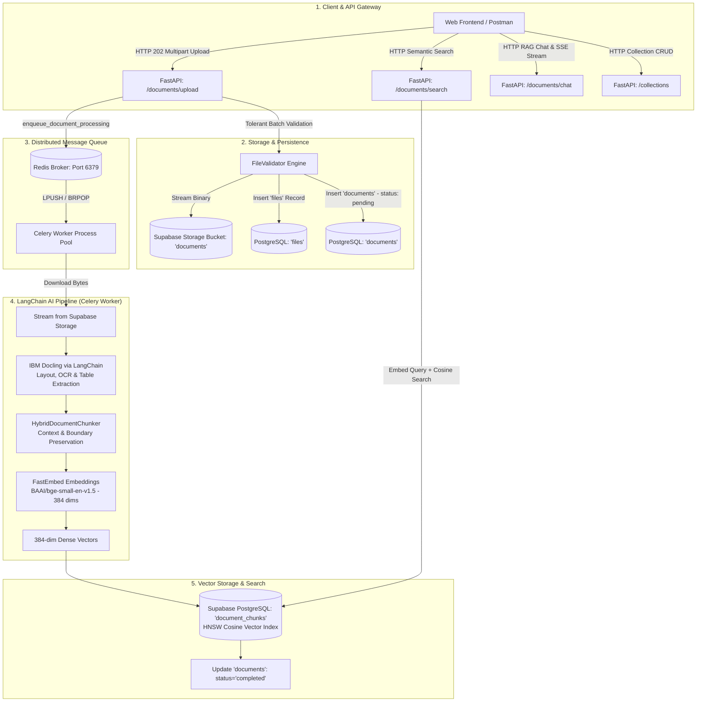

# AI Document Intelligence Platform — Technical Documentation Suite

Welcome to the comprehensive architecture and engineering documentation for the **AI Document Intelligence Platform**. 

This documentation is structured into dedicated, modular deep-dive guides. Each document explains the architecture, engineering decisions, database schemas, code flows, trade-offs, and edge cases with zero hand-waving.

---

## 🧭 Documentation Navigation

| Chapter | Document | Core Focus Areas |
| :---: | :--- | :--- |
| **01** | [**Storage Architecture & Document Ingestion**](./01_storage_and_ingestion.md) | Tolerant Batch Ingestion, Supabase Cloud Storage, Private Bucket Security, Signed URLs |
| **02** | [**Collections & Knowledge Base Organization**](./02_collections_and_organization.md) | Pattern B Hierarchy, Entity-Relationship Model, Two-Tier Cascade Delete, Upload Routing |
| **03** | [**Distributed Asynchronous Pipeline (Celery + Redis)**](./03_asynchronous_celery_pipeline.md) | Message Broker Queue, Process Isolation, Late ACKs, OOM Memory Safeguards, Worker Pools |
| **04** | [**Layout-Aware Parsing & Hybrid Chunking**](./04_parsing_and_chunking.md) | IBM Docling Engine, Table Integrity Preservation, LangChain Integration, Thread Isolation |
| **05** | [**Vector Embeddings & Supabase pgvector Indexing**](./05_embeddings_and_vector_store.md) | FastEmbed BGE Embeddings, PostgreSQL `pgvector`, HNSW Cosine Indexing, Multi-Tenant Scoping |
| **06** | [**Semantic Search, Chunks & Frontend Integration**](./06_semantic_search_and_api_guide.md) | Semantic Similarity Retrieval, Source Citations, UI Blueprints, Postman Integration |
| **07** | [**Pluggable LLM Layer & RAG Generation**](./07_llm_and_rag_orchestration.md) | Multi-Provider LLM Factory (Groq, Gemini, Ollama, OpenAI), Zero-Cost Setup, Smart Defaults |

---

## 1. System Architecture Overview

---

## 2. Core Subsystems Summary

| Subsystem | Primary Technologies | Key Technical Decision | Detailed Guide |
| :--- | :--- | :--- | :--- |
| **Document Ingestion** | FastAPI, `python-multipart`, Supabase Storage | **Two-Phase Atomic Validation:** If any file in a batch fails validation, zero bytes touch cloud storage and zero rows touch PostgreSQL. | [01_storage_and_ingestion.md](./01_storage_and_ingestion.md) |
| **Organization (Pattern B)** | PostgreSQL, SQLAlchemy, Alembic | **Knowledge Base Collections:** Documents are grouped into project-scoped smart folders with database & storage-level cascade deletion. | [02_collections_and_organization.md](./02_collections_and_organization.md) |
| **Async Task Queue** | Celery 5.6, Redis 8.1 | **Distributed Process Isolation:** Heavy OCR and embedding workloads run in isolated worker processes outside the web server with `task_acks_late=True`. | [03_asynchronous_celery_pipeline.md](./03_asynchronous_celery_pipeline.md) |
| **Document Parsing** | IBM Docling, LangChain | **Visual Layout Preservation:** Preserves complex multi-column tables as intact Markdown tables instead of flattening them into broken text. | [04_parsing_and_chunking.md](./04_parsing_and_chunking.md) |
| **Vector Storage** | FastEmbed, Supabase `pgvector`, HNSW | **Zero-API-Cost CPU Embeddings:** Uses quantized ONNX runtime (`bge-small-en-v1.5`) with PostgreSQL native HNSW vector indexes. | [05_embeddings_and_vector_store.md](./05_embeddings_and_vector_store.md) |
| **Search & APIs** | FastAPI, pgvector Cosine Search | **Cosine Similarity Retrieval:** Scoped by tenant (`user_id`) and optional knowledge base (`collection_id`). | [06_semantic_search_and_api_guide.md](./06_semantic_search_and_api_guide.md) |
| **RAG & Document Chat** | LangChain LCEL, Groq / Gemini / Ollama / OpenAI, SSE | **Grounded Synthesis & Inline Citations:** Uses strict anti-hallucination prompt templates, fast-exit empty context guard, and real-time Server-Sent Events token streaming with structured page/chunk citations. | [07_llm_and_rag_orchestration.md](./07_llm_and_rag_orchestration.md) |

---

## 3. Technology Stack Reference

* **Framework:** FastAPI (Python 3.12, async/await native)
* **Package & Environment Management:** `uv`
* **Relational Database:** PostgreSQL (Supabase Cloud Transaction Pooler)
* **Vector Database:** `pgvector` extension with HNSW Cosine Indexing
* **ORM & Database Migrations:** SQLAlchemy 2.0 (AsyncIO), Alembic
* **Cloud Storage:** Supabase Storage (S3-compatible, private bucket with signed URLs)
* **Task Queue & Message Broker:** Celery 5.6 + Redis 8.1
* **AI Orchestration:** LangChain Core, LangChain Groq, LangChain OpenAI, LangChain Google GenAI
* **LLM Engine:** Pluggable Factory supporting Groq (Llama 3.3 70B), Google Gemini 1.5 Flash, Ollama (offline local), and OpenAI
* **Document Parser:** IBM Docling (`langchain-docling`)
* **Embedding Model:** `BAAI/bge-small-en-v1.5` via FastEmbed (ONNX Runtime, 384 dimensions)
* **Authentication:** JWT with secure HTTP-only cookies, token rotation, and Google SMTP
