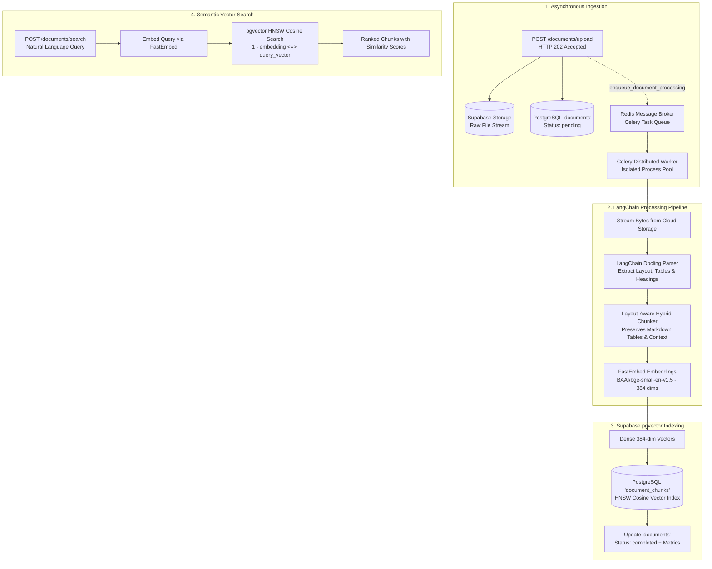
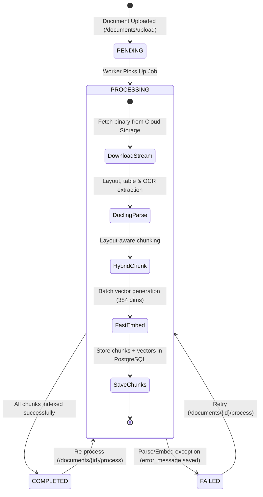

# Document Processing & Semantic Vector Pipeline Documentation

## 1. Executive Summary
This document details the production-grade architecture of the **Document Processing, Chunking, Embedding, and Vector Storage Pipeline** for the **AI Document Intelligence Platform**.

The pipeline seamlessly bridges raw document ingestion (PDFs, DOCX, Markdown, Text, and Images) to layout-aware structured text, dense vector embeddings, and ultra-fast semantic similarity retrieval via **Supabase PostgreSQL (`pgvector`)**.

---

## 2. Architecture & Design Principles



### Why this architecture was chosen:
1. **IBM Docling via LangChain (`langchain-docling`)**:
   - Traditional text splitters break tabular data across lines, destroying numerical relationships.
   - **Docling** understands document visual structure: it preserves multi-column tables intact as clean Markdown tables, links captions to sections, and maintains heading hierarchies.
2. **Local Quantized Embeddings (`FastEmbed`)**:
   - Uses `BAAI/bge-small-en-v1.5` running on a high-efficiency ONNX runtime.
   - **Zero API Cost & Unlimited Throughput:** Runs entirely on CPU without external API rate limits, network latency, or per-token charges.
   - Generates compact, highly discriminative 384-dimensional dense vectors.
3. **Supabase PostgreSQL `pgvector` with HNSW Indexing**:
   - Avoids adding a separate vector database (like Pinecone or Qdrant).
   - Relational data (user ownership, collection hierarchies, document metadata) and vector embeddings live together in one transactional database.
   - **HNSW (`vector_cosine_ops`)** delivers sub-millisecond approximate nearest neighbor retrieval even at scale.
4. **Distributed Task Queue with Celery & Redis**:
   - Document uploads return immediately with **`HTTP 202 Accepted`**.
   - Processing is handed off to **Celery** backed by Redis.
   - **Process Isolation:** Worker processes run outside the FastAPI web server, ensuring heavy OCR, table parsing, and PyTorch/ONNX matrix operations never starve web server threads or cause request timeouts.
   - **Fault Tolerance (`task_acks_late=True`):** If a worker process is terminated (e.g. OOM or container restart), the task is not lost; Redis re-delivers it to another worker.
   - **Automatic Retries:** Configured with exponential backoff (`max_retries=3`, `default_retry_delay=60`) on transient network or storage errors.

---

## 3. Database Schema & Vector Indexing

The pipeline introduces the `document_chunks` table integrated with the PostgreSQL `vector` extension.

```
┌─────────────────────────────────────────────────────────────────────────────┐
│                              collections                                    │
├─────────────────────────────────────────────────────────────────────────────┤
│ id (PK) | user_id (FK) | name | description | created_at | updated_at       │
└──────────────────────────────────────┬──────────────────────────────────────┘
                                       │ 1:N (CASCADE)
┌──────────────────────────────────────▼──────────────────────────────────────┐
│                                documents                                    │
├─────────────────────────────────────────────────────────────────────────────┤
│ id (PK) | user_id (FK) | collection_id (FK) | file_id (FK) | title          │
│ status: ['pending', 'processing', 'completed', 'failed']                   │
│ doc_metadata: JSONB (contains timings, chunk count, parser info)            │
└──────────────────────────────────────┬──────────────────────────────────────┘
                                       │ 1:N (CASCADE)
┌──────────────────────────────────────▼──────────────────────────────────────┐
│                             document_chunks                                 │
├─────────────────────────────────────────────────────────────────────────────┤
│ id (PK, UUID)                                                               │
│ document_id (FK -> documents.id, ON DELETE CASCADE)                         │
│ collection_id (FK -> collections.id, ON DELETE CASCADE, Nullable)           │
│ user_id (FK -> users.id, ON DELETE CASCADE)                                 │
│ content (TEXT)                                                              │
│ chunk_index (INTEGER, 0, 1, 2...)                                           │
│ token_count (INTEGER, estimated tokens)                                     │
│ char_count (INTEGER)                                                        │
│ chunk_metadata (JSONB: headings, provenance, doc items)                     │
│ embedding (vector(384), HNSW indexed)                                       │
│ created_at / updated_at (TIMESTAMPTZ)                                       │
└─────────────────────────────────────────────────────────────────────────────┘
```

### PostgreSQL Vector Optimization (Alembic Migration `c3bb51f6204a`):
```sql
-- 1. Enable pgvector
CREATE EXTENSION IF NOT EXISTS vector;

-- 2. HNSW Index for ultra-fast approximate cosine nearest neighbor search
CREATE INDEX idx_document_chunks_embedding 
ON document_chunks USING hnsw (embedding vector_cosine_ops);

-- 3. Composite B-Tree indexes for tenant-scoped querying
CREATE INDEX ix_document_chunks_user_doc 
ON document_chunks (user_id, document_id);

CREATE INDEX ix_document_chunks_collection_id 
ON document_chunks (collection_id);
```

---

## 4. Document Processing Lifecycle State Machine



1. **`pending`**: File is safely validated and stored in Supabase Storage; background task is enqueued.
2. **`processing`**: Background worker is actively running Docling parsing, chunking, or embedding.
3. **`completed`**: All chunks and dense vectors are indexed in PostgreSQL. `doc_metadata` contains detailed telemetry:
   ```json
   {
     "processing": {
       "parser": "docling",
       "chunker": "hybrid",
       "embedding_provider": "fastembed",
       "embedding_model": "BAAI/bge-small-en-v1.5",
       "total_chunks": 3,
       "parse_duration_seconds": 2.187,
       "chunk_duration_seconds": 0.001,
       "embed_duration_seconds": 0.963,
       "total_duration_seconds": 3.151
     }
   }
   ```
4. **`failed`**: Any unexpected parsing failure records the root cause in `error_message`, allowing safe retries without corrupted state.

---

## 5. API Reference

### 1. Trigger / Re-process Document
* **Endpoint:** `POST /documents/{document_id}/process`
* **Query Params:** `run_in_background=true` (default) or `false` (synchronous execution)
* **Auth:** Bearer JWT
* **Response:** `202 Accepted`
```json
{
  "success": true,
  "message": "Document processing queued in the background",
  "data": {
    "document_id": "0fa373fd-7280-4e74-8de5-6a83d006d1e7",
    "status": "queued",
    "total_chunks": 0,
    "error_message": null,
    "doc_metadata": null,
    "updated_at": "2026-10-22T15:40:00Z"
  }
}
```

---

### 2. Get Parsed Document Chunks
* **Endpoint:** `GET /documents/{document_id}/chunks?limit=100&offset=0`
* **Auth:** Bearer JWT
* **Response:** `200 OK`
```json
{
  "success": true,
  "message": "Document chunks retrieved successfully",
  "data": {
    "document_id": "0fa373fd-7280-4e74-8de5-6a83d006d1e7",
    "total_chunks": 3,
    "chunks": [
      {
        "id": "2bc083cf-8738-4e89-a3ae-87e2f5f14e5a",
        "document_id": "0fa373fd-7280-4e74-8de5-6a83d006d1e7",
        "collection_id": null,
        "chunk_index": 1,
        "content": "Q4 Financial Summary\nRevenue by Region\nNorth America, Q4 Revenue = $45M. YoY Growth = +32%",
        "token_count": 56,
        "char_count": 225,
        "metadata": {
          "headings": ["Q4 Financial Summary", "Revenue by Region"],
          "origin": { "filename": "q4_financial_summary.md" }
        },
        "created_at": "2026-10-22T15:43:44.200Z"
      }
    ]
  }
}
```

---

### 3. Semantic Vector Search
* **Endpoint:** `POST /documents/search`
* **Auth:** Bearer JWT
* **Body:**
```json
{
  "query": "How much revenue did North America generate in Q4?",
  "collection_id": "optional-collection-uuid",
  "document_id": "optional-document-uuid",
  "limit": 5
}
```
* **Response:** `200 OK`
```json
{
  "success": true,
  "message": "Found 3 matching chunk(s)",
  "data": [
    {
      "id": "2bc083cf-8738-4e89-a3ae-87e2f5f14e5a",
      "document_id": "0fa373fd-7280-4e74-8de5-6a83d006d1e7",
      "collection_id": null,
      "content": "Q4 Financial Summary\nRevenue by Region\nNorth America, Q4 Revenue = $45M. YoY Growth = +32%",
      "metadata": {
        "headings": ["Q4 Financial Summary", "Revenue by Region"]
      },
      "similarity": 0.7989
    }
  ]
}
```

---

## 6. Directory Structure

```
app/modules/processing/
├── __init__.py               # Exports DocumentChunk model & processing_router
├── models.py                 # SQLAlchemy DocumentChunk model with Vector(384)
├── schemas.py                # Pydantic schemas for requests, chunks, and search
├── enums.py                  # ProcessingStage enum
├── parsers/
│   ├── __init__.py
│   ├── base.py               # BaseDocumentParser protocol
│   └── docling_parser.py     # LangChain DoclingLoader wrapper (thread-isolated)
├── chunkers/
│   ├── __init__.py
│   ├── base.py               # BaseChunker protocol
│   └── hybrid_chunker.py     # Layout-aware HybridDocumentChunker
├── embeddings/
│   ├── __init__.py
│   └── factory.py            # EmbeddingFactory (FastEmbed, OpenAI, Gemini)
├── vectorstore/
│   ├── __init__.py
│   └── supabase_store.py     # SupabaseVectorStoreAdapter (LangChain standard)
├── repository.py             # DocumentChunkRepository (pgvector <=> cosine search)
├── pipeline.py               # DocumentProcessingPipeline orchestrator
├── service.py                # ProcessingService (state transitions & telemetry)
├── tasks.py                  # Celery tasks (process_document_task) with auto-retries
├── dependencies.py           # Dependency injection & embedding cache
└── router.py                 # REST API endpoints (/chunks, /process, /search)
```

---

## 7. Running the Celery Worker

In development or production, run the Celery worker process separately from the FastAPI web server:

### Windows (Local Development):
Celery on Windows requires the `solo` pool:
```bash
uv run celery -A core.celery_app.celery_app worker --loglevel=info -P solo
```
Or via python venv:
```bash
.venv\Scripts\celery -A core.celery_app.celery_app worker --loglevel=info -P solo
```

### Linux / Docker / Production:
```bash
celery -A core.celery_app.celery_app worker --loglevel=info --concurrency=4 -E
```

### Celery Configuration Flags:
* `task_acks_late=True`: Tasks are only removed from the queue after successful execution; worker crashes re-queue the task automatically.
* `worker_prefetch_multiplier=1`: Workers fetch only 1 heavy document task at a time to prevent memory exhaustion.
* `CELERY_TASK_ALWAYS_EAGER=false`: When set to `true` (e.g. during offline unit tests), tasks execute locally without needing a Redis server.
