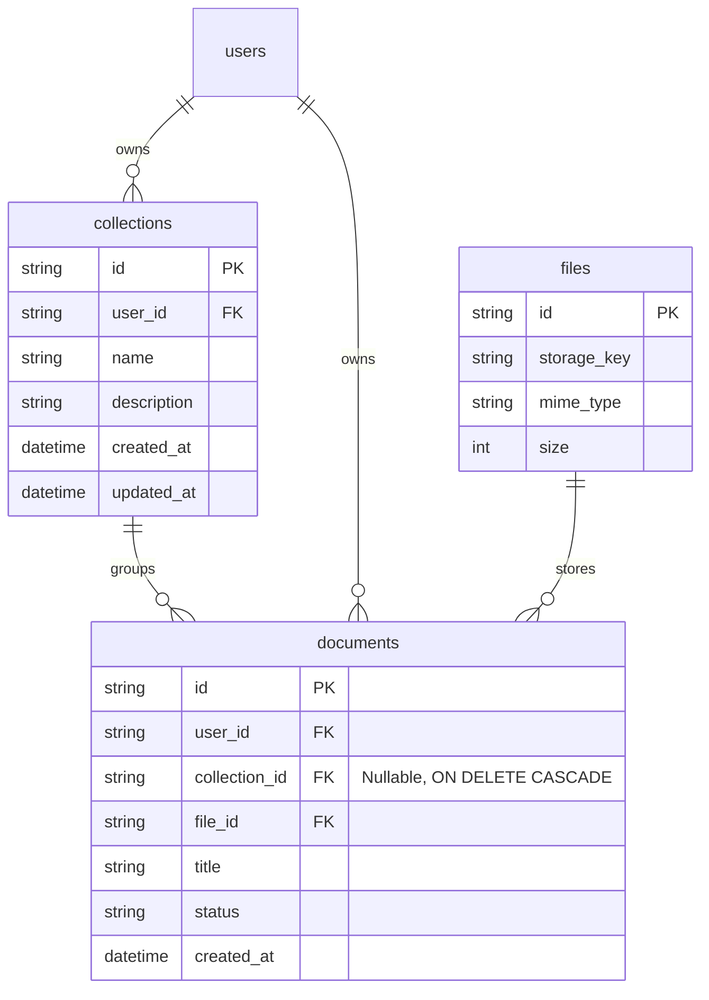
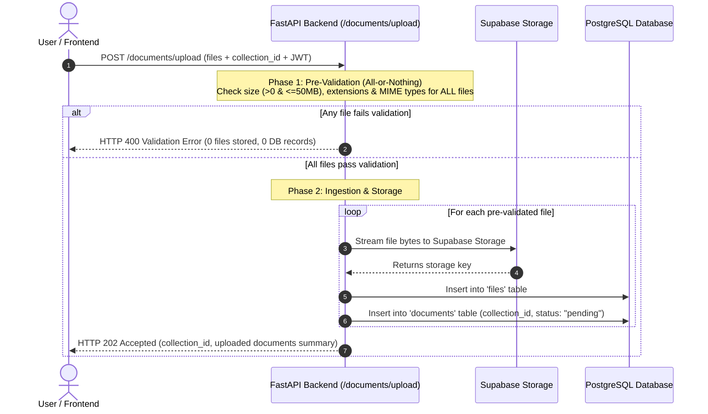

# Document & Collection System Documentation

## 1. Overview
The Document & Collection System is the foundational layer for the **AI Document Intelligence Platform**. It provides:
1. **Collections (Knowledge Bases / Smart Folders)**: Group related documents (e.g., "Tax Year 2025", "HR Policies", "Legal Contracts") so that AI chat and search can be scoped across specific projects.
2. **Multi-File & Mixed-Format Uploads**: Accepts single or batch uploads (PDFs, Word docs, photos, scans) in a single request.
3. **Cloud Storage**: Secure storage in **Supabase Storage** (or Amazon S3 / local fallback).
4. **Instant 202 Accepted Contract**: Non-blocking response returning `document_id`s with `pending` status, ready for asynchronous AI processing.
5. **Cascade Deletion**: When a collection is deleted, all documents and records inside it are automatically cascade deleted.

---

## 2. Architecture & Data Model



---

## 3. How the Upload Flow Works (Atomic All-or-Nothing Pre-Validation)



### Detailed Steps:
1. **Authentication Check**: Validates user's JWT access token.
2. **Collection Resolution**:
   - If `collection_id` is supplied: Verifies ownership of the collection.
   - If `collection_name` is supplied: Automatically looks up or creates the collection on the fly!
   - If neither is supplied: Uploads as an unassigned standalone document.
3. **Phase 1: Atomic Pre-Validation (All-or-Nothing)**:
   - Evaluates **every single file** in the batch before touching cloud storage or database.
   - Checks:
     - **Non-Empty**: File must have $>0$ bytes.
     - **Size Ceiling**: Must not exceed **50 MB**.
     - **Extension Whitelist**: Must match supported extension (`.pdf`, `.docx`, `.doc`, `.txt`, `.csv`, `.md`, `.png`, `.jpg`, `.jpeg`, `.webp`, `.tiff`, `.bmp`).
     - **MIME Whitelist**: MIME type must match allowed formats (with automatic extension fallback if browser sends generic octet-stream).
   - **Crucial Rule**: If **even one** file fails validation, the entire batch is rejected immediately with HTTP 400. **Zero files are uploaded to Supabase Storage, and zero records are created in PostgreSQL.**
4. **Phase 2: Storage Persistence & Ingestion**:
   - Only runs after 100% of files have passed Phase 1.
   - Streams files into Supabase Storage under `documents/{owner_id}/{uuid}.ext`.
   - Inserts records into `files` and `documents` tables with status `pending`.
   - Includes automatic rollback: if any unhandled storage or network failure occurs during the batch, any files already streamed in that request are purged from storage.
5. **Instant Response**:
   - Returns HTTP `202 Accepted` with summary of all uploaded documents.

---

## 4. Supported Formats & Limits

| Category | Supported Extensions | MIME Types |
| :--- | :--- | :--- |
| **Documents** | `.pdf`, `.docx`, `.doc`, `.txt`, `.md`, `.csv` | `application/pdf`, `application/vnd.openxmlformats-officedocument.wordprocessingml.document`, `text/plain`, `text/markdown`, `text/csv` |
| **Images** | `.png`, `.jpg`, `.jpeg`, `.webp`, `.tiff`, `.bmp` | `image/png`, `image/jpeg`, `image/webp`, `image/tiff`, `image/bmp` |
| **Max File Size**| **50 MB** per file | Enforced during upload |
| **Batch Upload** | **Supported** | Upload 1 or 30+ mixed documents/photos in a single request |

---

## 5. API Reference

### Collections Endpoints

#### 1. Create a Collection
- **Endpoint**: `POST /collections`
- **Headers**: `Authorization: Bearer <access_token>`, `Content-Type: application/json`
- **Body**:
  ```json
  {
    "name": "Tax Year 2025",
    "description": "All tax documents, expenses, and invoices"
  }
  ```
- **Response (`201 Created`)**:
  ```json
  {
    "success": true,
    "message": "Collection created successfully",
    "data": {
      "id": "52f3ce49-8796-4226-a47e-8a6ff80f837e",
      "user_id": "user-uuid",
      "name": "Tax Year 2025",
      "description": "All tax documents, expenses, and invoices",
      "document_count": 0,
      "created_at": "2026-10-22T01:28:30Z",
      "updated_at": "2026-10-22T01:28:30Z"
    }
  }
  ```

#### 2. List Collections
- **Endpoint**: `GET /collections?limit=50&offset=0`
- **Response (`200 OK`)**: Returns all collections owned by the user with real-time `document_count`.

#### 3. Get Collection Details
- **Endpoint**: `GET /collections/{collection_id}`
- **Response (`200 OK`)**: Returns details and document count for that specific collection.

#### 4. Update Collection
- **Endpoint**: `PATCH /collections/{collection_id}`
- **Body**: `{"name": "Updated Name", "description": "New description"}`

#### 5. Delete Collection (Cascade Delete)
- **Endpoint**: `DELETE /collections/{collection_id}`
- **Behavior**: Deletes the collection. Automatically **cascades and deletes all documents** inside it from PostgreSQL.

---

### Documents Endpoints

#### 1. Upload Document(s) (Single or Batch, into a Collection)
- **Endpoint**: `POST /documents/upload`
- **Content-Type**: `multipart/form-data`
- **Headers**: `Authorization: Bearer <access_token>`
- **Form Fields**:
  - `files`: One or multiple files (`<input type="file" name="files" multiple />`).
  - `file`: Also accepted for single-file clients.
  - `collection_id`: Optional UUID of an existing collection.
  - `collection_name`: Optional name (auto-creates collection if `collection_id` is omitted).
  - `title`: Optional custom title (when uploading a single file).

**Response (`202 Accepted`)**:
```json
{
  "success": true,
  "message": "3 documents accepted for processing into collection",
  "data": {
    "collection_id": "52f3ce49-8796-4226-a47e-8a6ff80f837e",
    "uploaded": [
      {
        "document_id": "6be059f3-0a58-4bd2-9e2e-6019cf6c1500",
        "collection_id": "52f3ce49-8796-4226-a47e-8a6ff80f837e",
        "status": "pending",
        "filename": "w2_form.pdf",
        "mime_type": "application/pdf",
        "file_size": 1048576,
        "created_at": "2026-10-22T01:29:45Z"
      },
      {
        "document_id": "9c1035ba-c6a1-462c-8d06-f47f1b75a24a",
        "collection_id": "52f3ce49-8796-4226-a47e-8a6ff80f837e",
        "status": "pending",
        "filename": "receipt_jan.png",
        "mime_type": "image/png",
        "file_size": 524288,
        "created_at": "2026-10-22T01:29:45Z"
      }
    ],
    "failed": [],
    "total_uploaded": 2,
    "total_failed": 0,
    "document_id": "6be059f3-0a58-4bd2-9e2e-6019cf6c1500"
  }
}
```

#### 2. Get Document Details
- **Endpoint**: `GET /documents/{document_id}`
- **Response (`200 OK`)**: Returns status, collection_id, metadata, and signed download URL.

#### 3. List Documents (Filter by Collection)
- **Endpoint**: `GET /documents?collection_id={collection_id}&limit=50&offset=0`
- **Response (`200 OK`)**: Lists documents, optionally filtered by `collection_id`.

---

## 6. Codebase File Structure

| File | Purpose |
| :--- | :--- |
| [`app/modules/collections/models.py`](file:///D:/Code/Projects/ai-document-intelligence-platform/app/modules/collections/models.py) | SQLAlchemy model for `collections` table. |
| [`app/modules/collections/schemas.py`](file:///D:/Code/Projects/ai-document-intelligence-platform/app/modules/collections/schemas.py) | Pydantic request/response schemas for collections. |
| [`app/modules/collections/repository.py`](file:///D:/Code/Projects/ai-document-intelligence-platform/app/modules/collections/repository.py) | Collection CRUD with real-time document counting. |
| [`app/modules/collections/service.py`](file:///D:/Code/Projects/ai-document-intelligence-platform/app/modules/collections/service.py) | Business logic, unique name checks, cascade deletions. |
| [`app/modules/collections/router.py`](file:///D:/Code/Projects/ai-document-intelligence-platform/app/modules/collections/router.py) | REST API endpoints for `/collections`. |
| [`app/modules/documents/models.py`](file:///D:/Code/Projects/ai-document-intelligence-platform/app/modules/documents/models.py) | `Document` model with foreign key to `collections.id`. |
| [`app/modules/documents/service.py`](file:///D:/Code/Projects/ai-document-intelligence-platform/app/modules/documents/service.py) | Multi-file and collection-linked document uploads. |
| [`app/modules/documents/router.py`](file:///D:/Code/Projects/ai-document-intelligence-platform/app/modules/documents/router.py) | Upload and listing endpoints supporting `collection_id`. |
