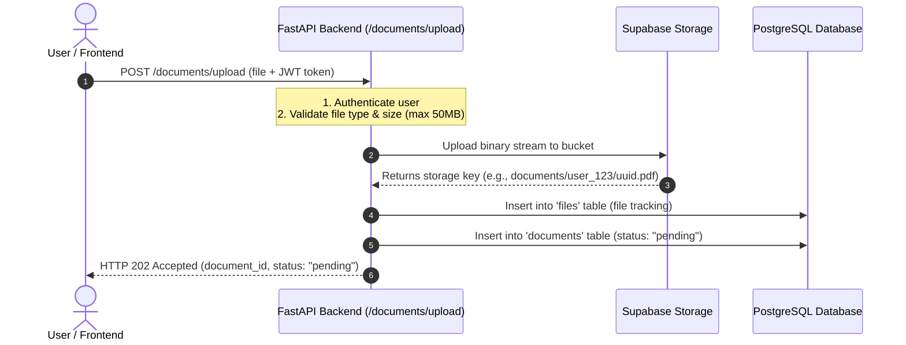

# Document Upload System Documentation

## 1. Overview
The Document Upload System is the entry point for the **AI Document Intelligence Platform**. It accepts document and image files from the frontend/user, securely stores them in **Supabase Storage** (or Amazon S3 / local storage), tracks their metadata in **PostgreSQL**, and immediately returns a **`202 Accepted`** response with a unique `document_id`.

### Why `202 Accepted`?
Document processing (OCR, text parsing, chunking, and vector embedding) can take several seconds or minutes for large multi-page PDFs or high-resolution images. Returning `202 Accepted` ensures:
- The user is **never blocked** waiting for parsing or embedding.
- The frontend gets an instant confirmation with a `document_id`.
- The document is safely saved in cloud storage with a `pending` status, ready for background workers to process.

---

## 2. How the Upload Flow Works



### Detailed Steps:
1. **Authentication Check**: The user must provide a valid JWT access token (via cookie or `Authorization: Bearer <token>` header).
2. **File Validation**:
   - Checks the MIME type and file extension against allowed formats.
   - Verifies the file does not exceed the **50 MB** limit.
3. **Storage Persistence**:
   - Streams the file into Supabase Storage under a unique path: `documents/{owner_id}/{generated_name}.ext`.
   - Automatically creates the `documents` bucket in Supabase if it does not exist yet.
4. **Database Registration**:
   - Creates a record in the `files` table for file management and storage key tracking.
   - Creates a record in the `documents` table with `status = "pending"`.
5. **Instant Response**:
   - Returns HTTP `202 Accepted` with the `document_id`, filename, size, and `pending` status.

---

## 3. Supported File Formats & Limits

| Category | Supported Extensions | MIME Types |
| :--- | :--- | :--- |
| **Documents** | `.pdf`, `.docx`, `.doc`, `.txt`, `.md`, `.csv` | `application/pdf`, `application/vnd.openxmlformats-officedocument.wordprocessingml.document`, `text/plain`, `text/markdown`, `text/csv` |
| **Images** | `.png`, `.jpg`, `.jpeg`, `.webp`, `.tiff`, `.bmp` | `image/png`, `image/jpeg`, `image/webp`, `image/tiff`, `image/bmp` |
| **Max File Size**| **50 MB** per file | Enforced during upload |

> [!NOTE]
> Images are fully supported because users frequently photograph documents, receipts, or invoices on mobile devices and upload them directly.

---

## 4. Configuration & Credentials

### Supabase Storage Setup (Active Default)
Configure the following keys in your **`.env`** file:

```env
# Storage Provider
STORAGE_PROVIDER=supabase

# Supabase Storage Configuration
SUPABASE_URL=https://your-project-ref.supabase.co
SUPABASE_KEY=your_supabase_service_role_key_or_anon_key
SUPABASE_STORAGE_BUCKET=documents
SUPABASE_SIGNED_URL_EXPIRE_SECONDS=3600
SUPABASE_BUCKET_PUBLIC=false
MAX_FILE_SIZE_MB=50
```

### Where to find your Supabase credentials:
1. Open your **[Supabase Dashboard](https://supabase.com/dashboard)**.
2. Select your project.
3. Navigate to **Project Settings** -> **API**.
4. Copy the **Project URL** into `SUPABASE_URL`.
5. Copy the **`service_role` secret** (recommended for backend storage) or **`anon` key** into `SUPABASE_KEY`.

> [!TIP]
> The backend automatically checks if the `documents` storage bucket exists in Supabase. If missing, it creates the bucket automatically.

---

## 5. API Endpoints

### 1. Upload a Document
- **Endpoint**: `POST /documents/upload`
- **Content-Type**: `multipart/form-data`
- **Headers**: `Authorization: Bearer <access_token>`
- **Form Body**:
  - `file`: The document or image file (required).
  - `title`: Optional custom title (defaults to original filename).

**Response (`202 Accepted`)**:
```json
{
  "success": true,
  "message": "Document accepted for processing",
  "data": {
    "document_id": "475a6b8c-cdfa-42c6-aa30-e6061e06dad3",
    "status": "pending",
    "filename": "quarterly_report.pdf",
    "mime_type": "application/pdf",
    "file_size": 1048576,
    "created_at": "2026-10-21T14:57:12.345678Z"
  }
}
```

---

### 2. Check Document Status & Details
- **Endpoint**: `GET /documents/{document_id}`
- **Headers**: `Authorization: Bearer <access_token>`

**Response (`200 OK`)**:
```json
{
  "success": true,
  "message": "Document retrieved successfully",
  "data": {
    "id": "475a6b8c-cdfa-42c6-aa30-e6061e06dad3",
    "user_id": "user_uuid_here",
    "file_id": "file_uuid_here",
    "title": "Quarterly Report",
    "original_filename": "quarterly_report.pdf",
    "mime_type": "application/pdf",
    "file_size": 1048576,
    "status": "pending",
    "error_message": null,
    "doc_metadata": null,
    "download_url": "https://ylfljvfmpjrhaeneuynx.supabase.co/storage/v1/object/sign/documents/...?token=...",
    "created_at": "2026-10-21T14:57:12.345678Z",
    "updated_at": "2026-10-21T14:57:12.345678Z"
  }
}
```

---

### 3. List User's Documents
- **Endpoint**: `GET /documents?limit=50&offset=0`
- **Headers**: `Authorization: Bearer <access_token>`

**Response (`200 OK`)**:
```json
{
  "success": true,
  "message": "Documents retrieved successfully",
  "data": {
    "documents": [
      {
        "id": "475a6b8c-cdfa-42c6-aa30-e6061e06dad3",
        "title": "Quarterly Report",
        "original_filename": "quarterly_report.pdf",
        "mime_type": "application/pdf",
        "file_size": 1048576,
        "status": "pending",
        "created_at": "2026-10-21T14:57:12.345678Z",
        "updated_at": "2026-10-21T14:57:12.345678Z"
      }
    ],
    "total": 1
  }
}
```

---

## 6. Codebase File Structure

| File | Purpose |
| :--- | :--- |
| [`app/infrastructure/storage/supabase.py`](file:///D:/Code/Projects/ai-document-intelligence-platform/app/infrastructure/storage/supabase.py) | Supabase Storage provider implementation using `storage3`. |
| [`app/infrastructure/storage/s3.py`](file:///D:/Code/Projects/ai-document-intelligence-platform/app/infrastructure/storage/s3.py) | Amazon S3 storage provider implementation (alternative). |
| [`app/infrastructure/storage/factory.py`](file:///D:/Code/Projects/ai-document-intelligence-platform/app/infrastructure/storage/factory.py) | Factory resolving `supabase`, `s3`, or `local`. |
| [`app/modules/documents/models.py`](file:///D:/Code/Projects/ai-document-intelligence-platform/app/modules/documents/models.py) | SQLAlchemy model for `documents` table. |
| [`app/modules/documents/schemas.py`](file:///D:/Code/Projects/ai-document-intelligence-platform/app/modules/documents/schemas.py) | Pydantic response models (including 202 upload response). |
| [`app/modules/documents/service.py`](file:///D:/Code/Projects/ai-document-intelligence-platform/app/modules/documents/service.py) | Upload orchestration, validation, and database operations. |
| [`app/modules/documents/router.py`](file:///D:/Code/Projects/ai-document-intelligence-platform/app/modules/documents/router.py) | FastAPI endpoints (`/documents/upload`, `/documents/{id}`, `/documents`). |
| [`app/modules/files/validators.py`](file:///D:/Code/Projects/ai-document-intelligence-platform/app/modules/files/validators.py) | 50MB size check and document/image MIME type validation. |
